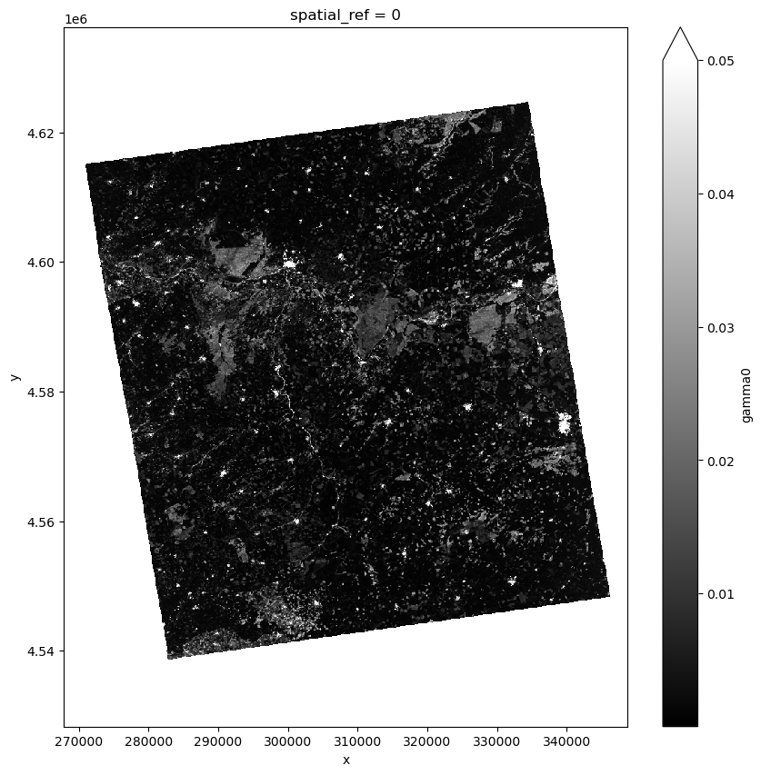
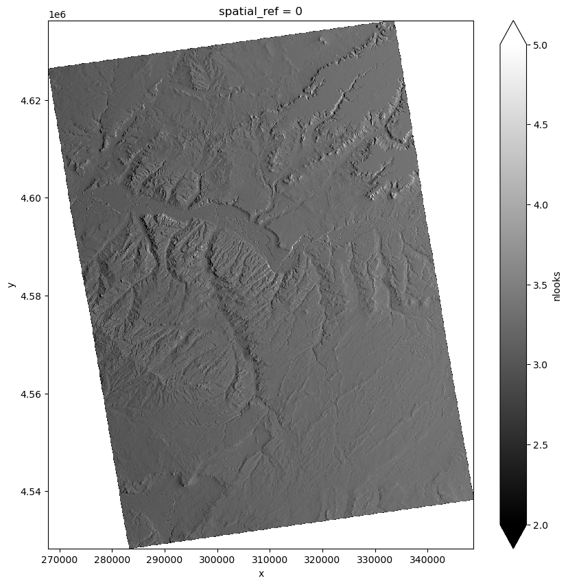
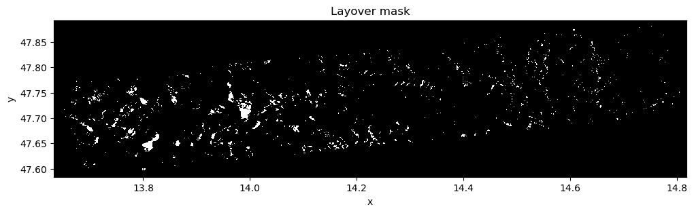
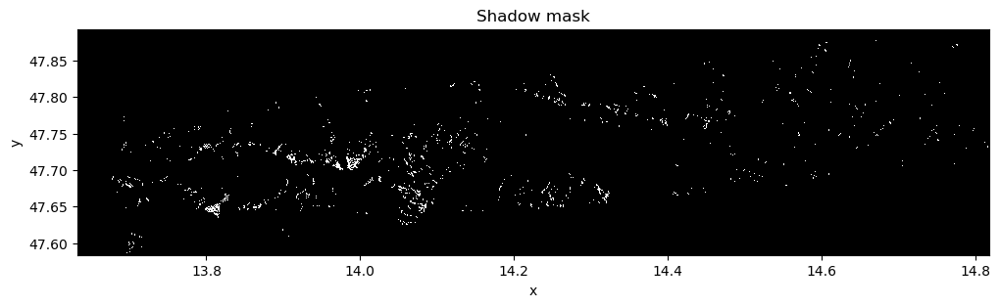

.. _area_projection_geocoding:

Area Projection Geocoding
~~~~~~~~~~~~~~~~~~~~~~~~~~~~~~~~~~~~

Overview
--------

The Area Projection Geocoding enables the projection of both real-valued and complex-valued 
images from radar geometry to ground geometry, using the Area Projection Matrix (APM). When 
the input is a flattened CSLC intensity image expressed as :math:`\gamma^0_r`, the result is 
the geocoded :math:`\gamma^0_g` map corresponding to the output geographic grid, leading to 
the generation of an NRB product.

This technique can also be applied to interferometric phase data such as INT or CMLC products, 
yielding as output the GINT product or the corresponding GMLC product in ground geometry. 
In the case of polarimetric data, where the input consists of a covariance matrix (COV) with 
complex-valued off-diagonal elements, Area Projection Geocoding can be used to derive the GCOV 
product.

Area Projection Geocoding is suitable for both full-resolution inputs, as in the case of NRB, 
and for multilooked data, as with GINT, GCOV, and GMLC. In addition, Area Projection Geocoding 
can be applied to binary masks—such as layover and shadow maps—allowing their projection to 
the ground geometry using the same matrix-based interpolation scheme. In this case, 
floating-point outputs are typically thresholded to recover boolean mask values in the 
geocoded domain.

Inputs
-------

- :math:`w`: Area Projection Matrix (APM)
- :math:`img_r`: Real or complex valued image in radar geometry
- :math:`ANF`: Area normalization factor in radar geometry (optional)

Outputs
--------

- :math:`img_g`: Geocoded image (e.g. radar cross-section :math:`\gamma^0_g`, generic complex variable :math:`cpx_g`)

Algorithm
----------

The Area Projection Geocoding enables the projection of both real-valued and complex-valued radar images from radar geometry to ground geometry.  
The process relies on the Area Projection Matrix (APM), which defines the linear combination required to compute the geocoded pixel values on the output geographic grid.

For **real-valued** input data, such as the flattened CSLC intensity image expressed as :math:`\gamma^0_r`, the geocoded map :math:`\gamma^0_g` is computed as follows:

.. math::
   :label: eq_cell_proj_real

   \gamma^0_g(x) = \frac{\sum_{i \in M_x} w_{x,i} \ \gamma^0_r(i)}{\sum_{i \in M_x} w_{x,i}}

Here, :math:`M_x` denotes the set of radar pixels contributing to the ground pixel :math:`x`, and :math:`w_{x,i}` are the corresponding weights. 
:numref:`area_based_geocoding_intensity_figure` illustrates the intensity image obtained from a SAOCOM acquisition over Salamanca (ES) in ascending geometry, beam S4.

.. _area_based_geocoding_intensity_figure:

   *Area based geocoding* intensity image corresponding to a SAOCOM acquisition over Salamanca (ES) in ascending geometry, beam S4.

This formulation is equivalent to a weighted multilooking operation and produces the NRB product, and the normalization coefficient in :eq:`eq_cell_proj_real` 
represents the number of looks :math:`nlook_{x}` associated with output resolution cell :math:`x`. :numref:`area_based_geocoding_nlook_figure` 
illustrates the number of looks image obtained from the same SAOCOM acquisition over Salamanca (ES) in ascending geometry, beam S4.

.. _area_based_geocoding_nlook_figure:

   *Area based geocoding* nlook image corresponding to a SAOCOM acquisition over Salamanca (ES) in ascending geometry, beam S4.

The :math:`\gamma^0_r` represents the flattened CSLC intensity in radar geometry, and it is obtained from CSLC product by applying the 
noise calibration as described :ref:`noise-removal <noise_removal>` and the Area Normalization Factor (ANF) as described in :ref:`Gamma-flattening <gamma_flattening>`. 

**Layover and shadow masks** are projected using the same matrix, but since masks are expected to be boolean, the floating-point result 
of the matrix multiplication is thresholded to restore a binary format.

In order to show a significative example of layover and shadow mask, an area in Alpine region over Salzburg (AT), acquired by Sentinel-1 
in IW mode is reported in :numref:`area_based_geocoding_lay_figure` and :numref:`area_based_geocoding_shw_figure` respectively.

.. _area_based_geocoding_lay_figure:

   *Area based geocoding* layover mask corresponding to a Sentinel-1 acquisition over Salzburg (AT) in IW mode.

.. _area_based_geocoding_shw_figure:

   *Area based geocoding* shadow mask corresponding to a Sentinel-1 acquisition over Salzburg (AT) in IW mode.

For **complex-valued** input data — such as interferometric phase (INT), multichannel (CMLC), or covariance matrix (COV) products — the Area 
Projection Geocoding applies the same APM to the complex-valued samples:

.. math::
   :label: eq_cell_proj_complex

   cpx_g(x) = \frac{\sum_{i \in M_x} w_{x,i} \ cpx_r(i)}{\sum_{i \in M_x} w_{x,i}}

where :math:`M_x` denotes the set of radar pixels contributing to the ground pixel :math:`x`, and for a radar cell :math:`i` belonging to :math:`M_x`, 
:math:`cpx_r(i)` is the complex value in radar coordinates and :math:`cpx_g(x)` is the corresponding geocoded complex value.  
This formulation yields the GINT, GMLC, or GCOV product, depending on the input.

It is assumed that the complex data are already in baseband (i.e., any phase modulation from acquisition geometry has been removed). 
If this condition is not met, phase flattening must be applied before geocoding.

In both cases, the projection framework is adaptable to multilooked input and output data. If the radar pixels are averaged prior to projection by a 
factor :math:`(m_r, m_a)` in slant range and azimuth, the inputs and APM must be adjusted accordingly:

.. math::
   :label: eq_multilook_avg

   \bar{\gamma}^{0}_r(i) = \frac{1}{m_r m_a} \sum_{l \in I_r(i)} \gamma^0_r(l)

.. math::
   :label: eq_multilook_weights

   \bar{w}_{x,i} = \sum_{l \in I_r(i)} w_{x,l}

Additionally, output cells can be grouped and averaged by summing projection weights across neighboring output pixels:

.. math::
   :label: eq_output_averaging

   \bar{w}_{x,i} = \sum_{y \in I_g(x)} w_{y,i}

Detailed variable description
-----------------------------

.. list-table:: Variable Description Table
   :widths: 25 50
   :header-rows: 1

   * - Property
     - Value
   * - Symbol
     - :math:`img_r`
   * - Description
     - Input real or complex image to be projected
   * - Purpose
     - Input
   * - Units
     - N/A
   * - Type
     - float/complex matrix
   * - Dimensionality
     - (range, azimuth)
   * - Range of values
     - N/A
   * - Initial/default values
     - N/A
   * - Name in pseudo-code
     - N/A
   * - 
     -
   * - Symbol
     - :math:`ANF`
   * - Description
     - Area normalization factor in radar geometry
   * - Purpose
     - Input
   * - Units
     - N/A
   * - Type
     - float matrix
   * - Dimensionality
     - (range, azimuth)
   * - Range of values
     - N/A
   * - Initial/default values
     - N/A
   * - Name in pseudo-code
     - N/A
   * - 
     -
   * - Symbol
     - :math:`{w}_{x,i}`
   * - Description
     - Weigths to be applied the full-resolution input image to project it to the output grid.
   * - Purpose
     - Internal
   * - Units
     - N/A
   * - Type
     - float matrix (sparse)
   * - Dimensionality
     - (ground cell, radar cell)
   * - Range of values
     - :math:`[0, 1]`
   * - Initial/default values
     - N/A
   * - Name in pseudo-code
     - N/A
   * - 
     -
   * - Symbol
     - :math:`\bar{w}_{x,i}`
   * - Description
     - Weigths to be applied the multilooked input image to project it to the output grid.
   * - Purpose
     - Internal
   * - Units
     - N/A
   * - Type
     - float matrix (sparse)
   * - Dimensionality
     - (ground cell, radar cell)
   * - Range of values
     - :math:`[0, 1]`
   * - Initial/default values
     - N/A
   * - Name in pseudo-code
     - N/A
   * - 
     -
   * - Symbol
     - :math:`(m_r, m_a)`
   * - Description
     - Multilook factor in range and azimuth direction.
   * - Purpose
     - Internal
   * - Units
     - pixels
   * - Type
     - int
   * - Dimensionality
     - (range multilook factor, azimuth multilook factor)
   * - Range of values
     - :math:`\ge 0`
   * - Initial/default values
     - (1,1)
   * - Name in pseudo-code
     - N/A
   * - 
     -
   * - Symbol
     - :math:`\gamma^0_{r}`
   * - Description
     - Radar cross-section gamma-nought in radar geometry
   * - Purpose
     - Internal
   * - Units
     - N/A
   * - Type
     - float matrix
   * - Dimensionality
     - (range, azimuth)
   * - Range of values
     - N/A
   * - Initial/default values
     - N/A
   * - Name in pseudo-code
     - N/A
   * - 
     -
   * - Symbol
     - :math:`\gamma^0_{g}`
   * - Description
     - Radar cross-section gamma-nought in ground geometry
   * - Purpose
     - Output
   * - Units
     - N/A
   * - Type
     - float matrix
   * - Dimensionality
     - (x, y)
   * - Range of values
     - N/A
   * - Initial/default values
     - N/A
   * - Name in pseudo-code
     - N/A
   * - 
     -

