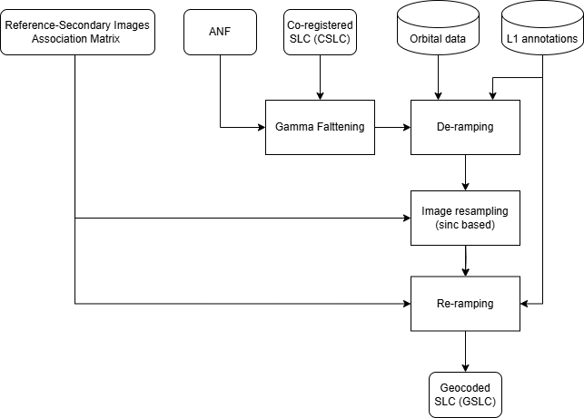

.. _phase_geocoding:

Point Projection Geocoding
~~~~~~~~~~~~~~~~~~~~~~~~~~~~~

Overview
--------

Point projection geocoding is the process of obtaining the CSLC product in ground geometry.  
This is achieved by resampling the deramped CSLC image onto the output geographic grid while preserving the spectral content of the original CSLC product.

Inputs
-------

- :math:`CSLC`: Co-registered Single Look Complex image  
- :math:`G2RAM_{ref}`: Reference Geo2Radar Association Matrix (Reference azimuth, slant range, line of sight, and height)
- :math:`ANF`: Area normalization factor in radar geometry (optional)

Outputs
--------

- :math:`GSLC`: Geocoded Single Look Complex image  

Algorithm
---------

Point projection geocoding allows obtaining the CSLC map corresponding to the output geographic grid.  
The phase of the GSLC is flattened with respect to the topographic phase, and its intensity may be flattened using the Area Normalization Factor (ANF).  
The spectral content of the CSLC image is preserved, meaning that the GSLC presents the same Doppler centroid and TOPSAR modulation (if present) as the input CSLC product.

The following diagram illustrates the flow of the point projection geocoding algorithm:

.. _point_based_geocoding_diagram_figure:

   *Point based geocoding* flow diagram.

The Reference Geo2Radar Association Matrix contains, for each point of the output geographic grid, the corresponding slant range and azimuth coordinates.  
This association generates a non-integer radar grid, requiring an interpolation procedure. Additionally, the association is generally spatially variant,  
causing the interpolation kernel to vary point by point.

The interpolation kernel is based on a windowed :math:`sinc()` interpolator.  
Ideally, the resampling could be performed independently for each pixel of the output image.

To perform the interpolation, the CSLC must be in baseband. To obtain the baseband signal (:math:`CSLC_{deramp}`),  
the deramping procedure is applied as described in :ref:`Phase deramping <phase_deramping>` using the demodulation polynomial in the CSLC annotations.

The procedure described in :ref:`Image resampling <regular_grid_to_sparse_grid_image_interpolation_sinc>`  
is applied to :math:`CSLC_{deramp}`, corresponding to the radar pixels associated with the ground cells.

The obtained interpolated and demodulated image must be re-modulated using the method described in :ref:`Phase reramping <phase_reramping>`.  
The final complex image is the :math:`GSLC` product.

If the amplitude of the GSLC product is requested to be flattened using the ANF, it is obtained from CSLC product by applying the Area Normalization Factor (ANF) as described in :ref:`Gamma-flattening <gamma_flattening>`.