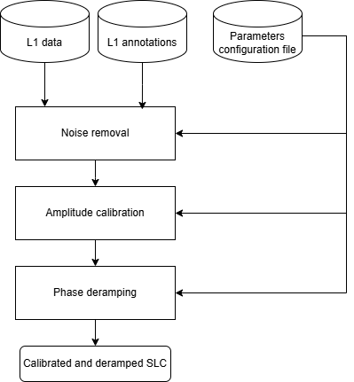

.. Copyright 2023 European Union

   Licensed under the Apache License, Version 2.0 (the "License");  
   you may not use this file except in compliance with the License.
   You may obtain a copy of the License at  

     http://www.apache.org/licenses/LICENSE-2.0  

   Unless required by applicable law or agreed to in writing, software  
   distributed under the License is distributed on an "AS IS" BASIS,  
   WITHOUT WARRANTIES OR CONDITIONS OF ANY KIND, either express or implied.  
   See the License for the specific language governing permissions and  
   limitations under the License.  

.. _calibration:  

Calibration  
~~~~~~~~~~~~~~~~~~~~~~~~  
The calibration unit provides functionalities for removing thermal noise, calibrating the amplitude, and deramping the phase of the input SLC image.  

The algorithm can be divided into three steps, executed in the following sequence:  

- :ref:`Noise removal <noise_removal>` (optional)  
- :ref:`Amplitude calibration <amplitude_calibration>`  
- :ref:`Phase deramping <phase_deramping>`  

The :numref:`calibration_unit_schema` shows a simplified schema of this functionality,  
with the necessary inputs and provided outputs.  

.. _calibration_unit_schema_figure:  

   Diagram of *Calibration Unit*.  

Specifically, the amplitude signal can be extracted from the input digital number (:math:`DN`)  
and converted to beta-nought (:math:`\beta^0`). Optionally, noise removal can be applied.  

The purpose of phase deramping is to compensate for phase modulation caused by the acquisition  
mode and geometry, ensuring the signal is reported in baseband. The demodulation process  
should account for both Doppler components: one due to the acquisition mode (in the case of TOPSAR)  
and the other due to the squint angle.  

At this stage, the calibrated SLC image is independent of the specific acquisition mode.  
As a result, subsequent operations requiring interpolation of data onto the output grid—whether  
the radar grid of the reference image (for CSLC products) or the ground grid (for GSLC and NRB products)—  
can be performed without further preprocessing.  

Additionally, the calibration module updates the image annotation by adding the applied  
demodulation phase function, allowing it to be removed if requested at the end of the co-registration process.  
