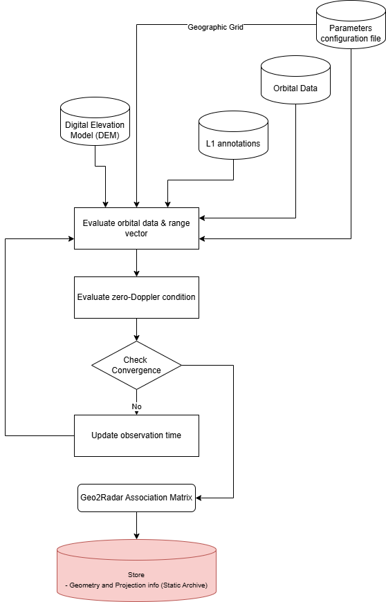

.. _coordinate_conversion:

Coordinate conversion
~~~~~~~~~~~~~~~~~~~~~~~~~~~~~~~~~~~~

Overview
--------
The Coordinates Conversion tool allows to compute accurately the azimuth observation time corresponding to a specific target on the ground. This mapping between ground and sensor is be based on the imposition of the Zero-Doppler condition. 

The procedures take into account: 

- Sensor acquisition geometry (Zero-Doppler)
- Orbital parameters (satellite position, velocity and acceleration)
- Digital Elevation Model 

Let :math:`\vec{v}` and :math:`\vec{p}` be the satellite velocity and position corresponding to the acquisition time :math:`t_a`, let :math:`\vec{r}` be the range vector connecting the satellite position :math:`P` and the target position on the ground :math:`\vec{T}`, the following condition has to be verified:

.. math::
   :label: eq_zero_doppler

   \vec{v}(t_a) \cdot \left( \vec{T} -\vec{p}(t_a) \right) = 0

:eq:`eq_zero_doppler`

Inputs
------

The *coordinate conversion* tool requires the following inputs:

- :math:`DEM`: Digital elevation model (DEM)
- :math:`annot`: L1 Image annotations
- :math:`orb`: Orbital data, including satellite position, velocity and acceleration

Outputs
-------
The *coordinate conversion* tool provides in output in corespondence of each point of the input DEM the following data:

- :math:`t_a`: Absolute observation time 
- :math:`\vec{r}`: Range vector, in ECEF coordinate reference system, connecting the satellite position :math:`\vec{p}` when observing the target on the gtound :math:`\vec{T}`.
- :math:`h`: height of the target on the ground, in the same reference system of the :math:`DEM`.

Processing parameters
---------------------
The *coordinate conversion* tool requires the following processing parameters:

- :math:`maxiter`: Maximum number of iterations for the Newton method
- :math:`\Delta t_{min}`: Convergence threshold for the Newton method

Algorithm
----------
The computation of the observation time :math:`t_a` is based on the solution of equation :eq:`eq_zero_doppler`. The iterative Newton method exploiting the derivatives of the objective function is able to arrive to the solution in few iterations, guarantiing very high accuracy. 

The first step is the trasformation of DEM coordinates into the ECEF coordinate reference system, if not already in that system. To do this open-source libraries exists to perform this transformation, such as `pyproj <https://pyproj4.github.io/pyproj/stable/>`_.
The method starts from an initial guess of the observation time (e.g. the burst center). The method iteratively refines this guess until convergence is reached. The orbital parameters (position, velocity and acceleration) are defined as polynomial functions, and can be easily computed at each iteration for the current guess of the observation time.

The :numref:`coordinate_conversion_schema` shows a simplified schema of this functionality, with the necessary inputs and the provided outputs.

.. _coordinate_conversion_schema_figure:

   Diagram of *Coordinates Conversion* step. 

.. math::
   :label: eq_newton_method_1

   \vec{r}=\vec{p}(t_{a,i})-\vec{T}

:eq:`eq_newton_method_1`

.. math::
   :label: eq_newton_method_2

   \Delta t_i = \frac{\vec{v}(t_{a,i}) \cdot \vec{r}}{\vec{a}(t_{a,i}) \cdot \vec{r} + |V(t_{a,i})|^2} = 0

:eq:`eq_newton_method_2`

.. math::
   :label: eq_newton_method_3
   
   t_{a,i+1} = t_{a,i} - \Delta t_i

:eq:`eq_newton_method_3`

The method stops when the absolute value of :math:`|\Delta t_i| <= \Delta t_{min}`, or when the maximum number of iterations is reached.

The Coordinates Conversion tool is used in the *Reference Geometry Unit* and in *Coregistration Unit* to compute the association between the Reference DEM and the radar grid.

Detailed variable description
-----------------------------

.. list-table:: Variable Description Table
   :widths: 25 50
   :header-rows: 1

   * - Property
     - Value
   * - Symbol
     - :math:`\vec{p}`
   * - Description
     - Satellite position
   * - Purpose
     - Input
   * - Units
     - N/A
   * - Type
     - float array
   * - Dimensionality
     - (azimuth)
   * - Range of values
     - N/A
   * - Initial/default values
     - N/A
   * - Name in pseudo-code
     - N/A
   * - 
     -
   * - Symbol
     - :math:`\vec{v}`
   * - Description
     - Satellite velocity
   * - Purpose
     - Input
   * - Units
     - N/A
   * - Type
     - float array
   * - Dimensionality
     - (azimuth)
   * - Range of values
     - N/A
   * - Initial/default values
     - N/A
   * - Name in pseudo-code
     - N/A
   * - 
     -
   * - Symbol
     - :math:`\vec{a}`
   * - Description
     - Satellite acceleration
   * - Purpose
     - Input
   * - Units
     - N/A
   * - Type
     - float array
   * - Dimensionality
     - (azimuth)
   * - Range of values
     - N/A
   * - Initial/default values
     - N/A
   * - Name in pseudo-code
     - N/A
   * - 
     -
   * - Symbol
     - :math:`\vec{T}`
   * - Description
     - Target on the ground
   * - Purpose
     - Input
   * - Units
     - N/A
   * - Type
     - float array
   * - Dimensionality
     - (x,y)
   * - Range of values
     - N/A
   * - Initial/default values
     - N/A
   * - Name in pseudo-code
     - N/A
   * - 
     -
   * - Symbol
     - :math:`t_a`
   * - Description
     - Zero-Doppler observation time
   * - Purpose
     - Output
   * - Units
     - N/A
   * - Type
     - float array
   * - Dimensionality
     - (x,y)
   * - Range of values
     - N/A
   * - Initial/default values
     - N/A
   * - Name in pseudo-code
     - N/A
   * - 
     -
   * - Symbol
     - :math:`\vec{r}`
   * - Description
     - Range vector connecting the satellite and the target on the ground
   * - Purpose
     - Output
   * - Units
     - N/A
   * - Type
     - float array
   * - Dimensionality
     - (x,y)
   * - Range of values
     - N/A
   * - Initial/default values
     - N/A
   * - Name in pseudo-code
     - N/A
   * - 
     -
   * - Symbol
     - :math:`h`
   * - Description
     - Height of the target on the ground
   * - Purpose
     - Output
   * - Units
     - N/A
   * - Type
     - float array
   * - Dimensionality
     - (x,y)
   * - Range of values
     - N/A
   * - Initial/default values
     - N/A
   * - Name in pseudo-code
     - N/A