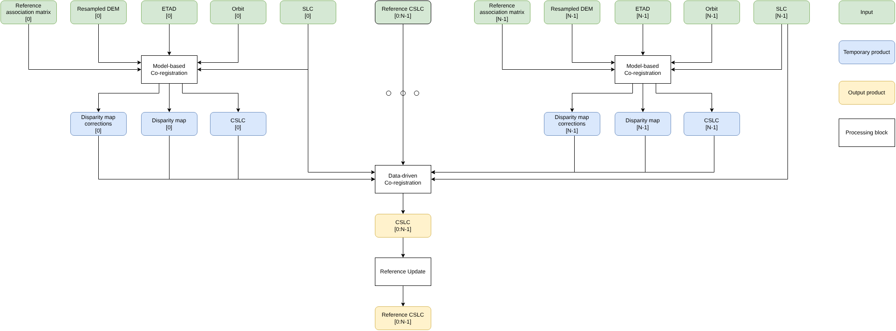

.. Copyright 2023 European Union

   Licensed under the Apache License, Version 2.0 (the "License");
   you may not use this file except in compliance with the License.
   You may obtain a copy of the License at

     http://www.apache.org/licenses/LICENSE-2.0

   Unless required by applicable law or agreed to in writing, software
   distributed under the License is distributed on an "AS IS" BASIS,
   WITHOUT WARRANTIES OR CONDITIONS OF ANY KIND, either express or implied.
   See the License for the specific language governing permissions and
   limitations under the License.

.. _coregistration:

Co-registration
~~~~~~~~~~~~~~~~~~~~

The *Co-registration Unit* generates Single Look Complex (SLC) images co-registered with respect to a radar reference grid. 
Each pixel of the co-registered SLC (CSLC) images represents the same ground target.

Two different and complementary approaches can be used to align SLC images:

- :ref:`Model based co-registration <coregistration_model_based>`: Align images with respect to a reference real or virtual image considering DEM, orbital data, timing corrections (e.g. ETAD). This module foresees the use of these specific utilities:

  - :ref:`Coordinate conversion <coordinate_conversion>`: computes the secondary image radar coordinates corresponding to the input DEM.
  - :ref:`Griddata <sparse_grid_to_regular_grid_image_interpolation_linear>`: calculates the difference between the reference and secondary range and azimuth coordinates to obtain the disparity map at the DEM nodes. The disparity map is then interpolated in the radar grid.
  - :ref:`Image Resampling <regular_grid_to_sparse_grid_image_interpolation_sinc>`: resamples the SLC image to the reference grid, correcting secondary image coordinates according to the ETAD if available.
  - :ref:`Phase Flattening <phase_flattening>`: applies phase flattening to the co-registered SLC image.
  - :ref:`Phase Reramping <phase_reramping>`: applies phase reramping to the co-registered SLC image.

- :ref:`Data driven co-registration <coregistration_data_driven>`: Align images with respect to a reference real image correcting the deformation between reference and secondary images exploiting image matching techniques and/or ESD. This module foresees the use of these specific utilities:

  - :ref:`Image matching <image_matching>`: compute the offset between reference and secondary images in correspondence of the reference image patches.
  - :ref:`Enhanced Spectral Diversity (ESD) <esd_matching>`: compute the double phase difference between reference and secondary images, between adjacent bursts, and estimate a common offset in azimuth direction :cite:`ESD2016`. This porcessing is enabled for TopSAR and ScanSAR acquisition modes.
  - :ref:`Rubber sheeting <rubber_sheeting>`: starting from the offsets estimated in correspondence of difference reference image patches, reconstruct the secondary image warping functions, merging the information with the outcomes of the model-based co-registration. 
  - :ref:`Image Resampling <regular_grid_to_sparse_grid_image_interpolation_sinc>`: resamples the secondary SLC image to the reference grid, correcting secondary image coordinates according to the ETAD if available and polynomial corrections from previous steps.
  - :ref:`Phase Flattening <phase_flattening>`: applies phase flattening to the co-registered SLC image.
  - :ref:`Phase Reramping <phase_reramping>`: applies phase reramping to the co-registered SLC image.
  - :ref:`Split spectrum <split_spectrum>`: compute the dispersive component of the phase delay (ionosphere), exploiting the phase difference between images acquired in correspondence of sub-bands with different carrier frequencies :cite:`Gomba2016`.

Usually, model-based registration is sufficient for C-band Copernicus Sentinel-1 SAR data, where precise orbit files in conjunction with ETAD corrections are adequate. In the case of L-band SAR data, a higher impact of the ionosphere is expected, and data-driven approaches must be adopted to correct large displacements in both slant-range and azimuth directions.

Model-based co‑registration does not require the definition of a real SAR reference image; it is sufficient to define a common reference grid, which can then be used throughout the entire mission lifecycle.

Conversely, in the case of a data-driven approach, a real SAR image is necessary. In addition, to maintain a sufficient degree of coherence between the reference and secondary images, it is necessary to implement a strategy to periodically update the reference image. The same approach proposed in :ref:`GMLP product generation <gmlp_label>` can be adopted.

A simple sketch of the co-registration process is shown in :numref:`coregistration_diagram`.

.. _coregistration_diagram_figure:

   *Co-registration* flow diagram.

.. toctree::
   :maxdepth: 1
   :hidden:

   coregistration_model_based
   coregistration_data_driven
