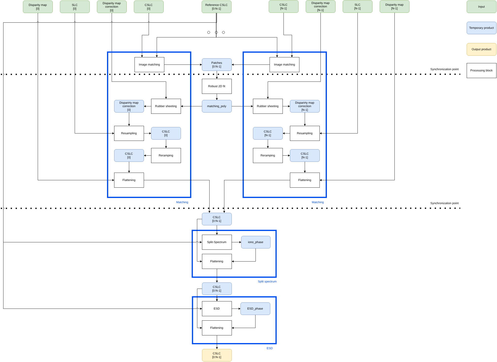

.. Copyright 2023 European Union

   Licensed under the Apache License, Version 2.0 (the "License");
   you may not use this file except in compliance with the License.
   You may obtain a copy of the License at

     http://www.apache.org/licenses/LICENSE-2.0

   Unless required by applicable law or agreed to in writing, software
   distributed under the License is distributed on an "AS IS" BASIS,
   WITHOUT WARRANTIES OR CONDITIONS OF ANY KIND, either express or implied.
   See the License for the specific language governing permissions and
   limitations under the License.

.. _coregistration_data_driven:

Data-Driven Co-registration
~~~~~~~~~~~~~~~~~~~~~~~~~~~~~~~~~~~~~~~~

The *Data driven co-registration* generates Single Look Complex (SLC) images co-registered with respect to a radar reference grid. 
Each pixel of the co-registered SLC (CSLC) images represents the same ground target.

CSLC products are derived from previously co-registered data with model based approach (Pre-coregistered, calibrated, Deramped, Demodulated SAR SLC), and *Geometry Unit* outputs (Geo2Radar Association Matrix ).

The model based co-registration is necessary to pre-align as much as possible the input images, compensating for geometric distorsions, phase topographic signature and acquisition mode phase modulation.

The determination of the residual local offsets is based on image complex or real :ref:`image matching <image_matching>`. 
In azimuth direction in case of TopSAR and ScanSAR acquisitions it is requested an higher accuracy with respect to the one achievable with image cross-correlation. In this case :ref:`Enhanced Spectral Diversity (ESD) <esd_matching>` technique has to be applied.

Once offset measurements have to be collected in correspondence of patches over all the image, a warping function has to be reconstructed. This process is also known as :ref:`rubber sheeting <rubber_sheeting>`.

The flow for data driven co-registration is shown in :numref:`data_driven_coregistration_diagram`.

.. _data_driven_coregistration_diagram_figure:

   *Data-driven Co-registration* flow diagram.

Key steps of the *Data-driven Co-registration*:

- :ref:`Image matching <image_matching>`: compute the offset between reference and secondary images in correspondence of the reference image patches.
- :ref:`Enhanced Spectral Diversity (ESD) <esd_matching>`: compute the double phase difference between reference and secondary images, between adjacent bursts, and estimate a common offset in azimuth direction :cite:`ESD2016`. This porcessing is enabled for TopSAR and ScanSAR acquisition modes.
- :ref:`Rubber sheeting <rubber_sheeting>`: Starting from the offsets estimated in correspondence of difference reference image patches, reconstruct the secondary images warping function, merging the information with the outcomes of the model-based co-registration. 
- :ref:`Image Resampling <regular_grid_to_sparse_grid_image_interpolation_sinc>`: resamples the secondary SLC image to the reference grid.
- :ref:`Phase Flattening <phase_flattening>`: applies phase flattening to the co-registered SLC image.
- :ref:`Phase Reramping <phase_reramping>`: applies phase reramping to the co-registered SLC image.
- :ref:`Split spectrum <split_spectrum>`: compute the dispersive component of the phase delay (ionosphere), exploiting the phase difference between images acquired in correspondence of sub-bands with different carrier frequencies :cite:`Gomba2016`.
