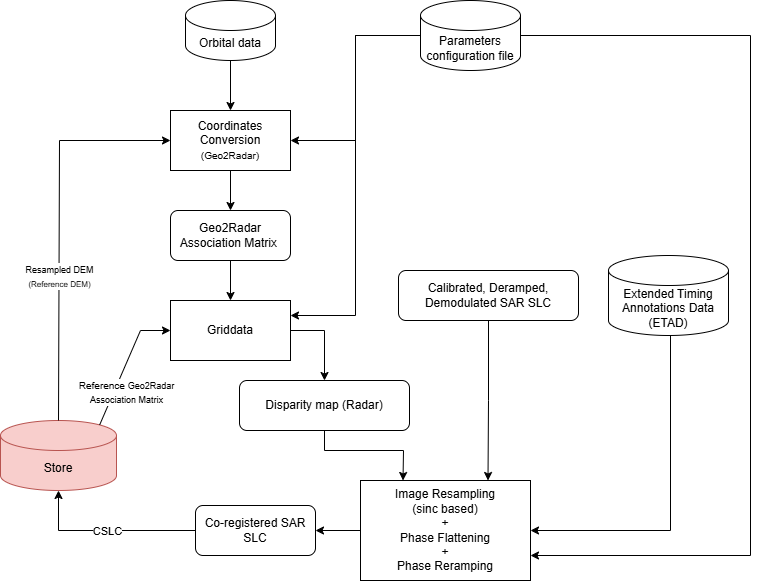

.. Copyright 2023 European Union

   Licensed under the Apache License, Version 2.0 (the "License");
   you may not use this file except in compliance with the License.
   You may obtain a copy of the License at

     http://www.apache.org/licenses/LICENSE-2.0

   Unless required by applicable law or agreed to in writing, software
   distributed under the License is distributed on an "AS IS" BASIS,
   WITHOUT WARRANTIES OR CONDITIONS OF ANY KIND, either express or implied.
   See the License for the specific language governing permissions and
   limitations under the License.

.. _coregistration_model_based:

Model-based Co-registration
~~~~~~~~~~~~~~~~~~~~~~~~~~~~~~~~~~~~~~~~

The *Model based co-registration* generates Single Look Complex (SLC) images co-registered with respect to a radar reference grid. 
Each pixel of the co-registered SLC (CSLC) images represents the same ground target.

CSLC products are derived from L1 data and *Geometry Unit* outputs.

The flow for CSLC production is shown in :numref:`model_based_coregistration_diagram`.

.. _model_based_coregistration_diagram_figure:

   *Model based Co-registration* flow diagram.

Key steps of the *Model based Co-registration*:

- :ref:`Coordinate conversion <coordinate_conversion>`: computes the secondary image radar coordinates corresponding to the input DEM.
- :ref:`Griddata <sparse_grid_to_regular_grid_image_interpolation_linear>`: calculates the difference between the reference and secondary range and azimuth coordinates to obtain the disparity map at the DEM nodes. The disparity map is then interpolated in the radar grid.
- :ref:`Image Resampling <regular_grid_to_sparse_grid_image_interpolation_sinc>`: resamples the SLC image to the reference grid.
- :ref:`Phase Flattening <phase_flattening>`: applies phase flattening to the co-registered SLC image.
- :ref:`Phase Reramping <phase_reramping>`: applies phase reramping to the co-registered SLC image.

Notice that, in case of NRB product generated directly from SLC, the *Co-registration Unit* is responsible only for applying ETAD corrections in the :ref:`Image Resampling <regular_grid_to_sparse_grid_image_interpolation_sinc>` step.
