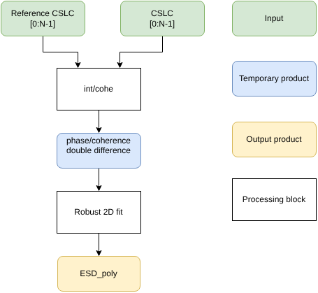

.. _esd_matching:

Enhanced Spectral Diversity (ESD)
~~~~~~~~~~~~~~~~~~~~~~~~~~~~~~~~~~~~

Overview
--------

The purpose of this utilitiy is to compute the fine shift in azimuth direction between a reference and a secondary image, by exploiting the interferometric double phase difference between the different acquisition dates and and the overlapping areas between bursts.
The proposed algorithm is based on :cite:`ESD2016`.

Inputs
-------

- :math:`slc_r^i` and :math:`slc_r^j`:: reference SLC image in correspondence of the adjacent bursts :math:`i` and :math:`j`
- :math:`slc_s^i` and :math:`slc_s^j`: secondary SLC image in correspondence of the adjacent bursts :math:`i` and :math:`j`

Outputs
--------

- :math:`\hat{\Delta t}_{a_s}`: offset in azimuth directions to be applied to the secondary image to match the reference image
- :math:`\Gamma(\Delta t_{a_s})`: Objective function in correspondence of the optimum shift

Algorithm
----------

Let :math:`i` and :math:`j` be the indices of two adjacent bursts.  
Let :math:`slc_r^q` and :math:`slc_s^q` denote the reference and secondary complex images corresponding to burst :math:`q`.  
Let :math:`\phi_{r,s}^{i,j}` be the phase difference between the two images and between the adjacent bursts.

.. math::
    :label: eq_phi_esd

    \phi_{r,s}^{i,j} = \angle \left[ \left( slc_r^i \cdot slc_s^j \right) \left( slc_s^i \cdot slc_r^j \right)^* \right]

This phase is related to the expected azimuth shift :math:`\Delta t_{a_s}^{i,j}` through the following expression:

.. math::
   :label: eq_esd

   \hat{\Delta t}_{a_s}^{\,i,j}
   = \arg\max_{\Delta t_{a_s}^{\,i,j}}
     \left|
       \sum_{p \in O_{i,j}}
       \exp^{
         j\!\left(
           \phi_{r,s}^{\,i,j}
           - 2\pi\, \Delta f_{DC}^{\,i,j}\, \Delta t_{a_s}^{\,i,j}
         \right)}
     \right|

A sketch of the ESD technique is shown in :numref:`esd_diagram`.

.. _esd_diagram_figure:

   Sketch of the ESD technique.

.. note::
    It is important that the phase modulation due to the acquisition geometry (e.g., topography) has been removed.  
    To improve reliability, the summation in :eq:`eq_esd` can be weighted using the interferometric coherence.

    The estimation of the azimuth shift in correspondence of the overlapping area between adjacent bursts can be ambiguous, and this ambibuity has to be resolved in the robust 2D fitting.

Code
-----

Function to compute the offset in azimuth direction associated to the overlapping area between two bursts (burst0 and burst).
Only points with coherence above a certain threshold (coherence_th) are considered valid.

.. code-block:: python

    def compute_azimuth_shifts(
        burst0: xr.Dataset,
        burst1: xr.Dataset,
        reference0: xr.Dataset,
        reference1: xr.Dataset,
        dtaz: float,
        eta: float,
        reference_dates: list[str],
        kernel_shape: list[int] = [3, 3],
        coherence_th: float = 0.7,
    ):

        """
        Estimate burst azimuth shifts between SAR acquisitions using ESD technique.

        This function computes sub-pixel azimuth shifts between two SAR bursts (burst0 and burst1) and their corresponding reference bursts
        using interferometric phase estimation and multilook coherence filtering. The shift is derived from the phase difference between 
        interferograms formed with the same reference scene.

        Parameters
        ----------
        burst0 : xr.Dataset
            First burst (SLC), co-registered.
        burst1 : xr.Dataset
            Second burst (SLC), co-registered.
        reference0 : xr.Dataset
            Reference dataset co-registered with burst0.
        reference1 : xr.Dataset
            Reference dataset co-registered with burst1.
        dtaz : float
            Azimuth sampling spacing in seconds.
        reference_dates : list of str
            Dates of the reference scenes to be used for computing interferograms.
        kernel_shape : list of int, optional
            Shape of the averaging kernel for coherence estimation (default: [3, 3]).
        coherence_th : float, optional
            Minimum coherence threshold for valid phase estimates (default: 0.7).

        Returns
        -------
        xr.Dataset
            An xarray Dataset with the following variables:
            - "reference_date": list of processed reference dates
            - "shift": DataArray of estimated azimuth shifts [seconds]
            - "coherence": DataArray of mean coherence values used in shift estimation
        """

        def compute_coherence(
            interf: xr.DataArray,
            power_s: xr.DataArray,
            power_m: xr.DataArray,
        ) -> xr.DataArray:

            # kernel creation #
            k = np.ones(kernel_shape) / np.prod(kernel_shape)

            # numerator computation #
            num = np.abs(conv.convolution_2d(interf.real.squeeze(), k) + 1j * conv.convolution_2d(interf.imag.squeeze(), k))

            # denominator computation #
            den = np.sqrt(conv.convolution_2d(power_s.squeeze(), k) * conv.convolution_2d(power_m.squeeze(), k))
            return (num / den).expand_dims("acquisition_date").compute()

        def compute_shift(reference_date: str, f_d: float, dtaz: float) -> tuple[xr.DataArray]:

            if all(reference_date in e.acquisition_date for e in [reference0, reference1]):

                # interferograms and power computation #
                pow0 = (burst0 * burst0.conj()).real
                interf0 = burst0 * reference0.sel(acquisition_date=reference_date).conj()
                interf1 = burst1 * reference1.sel(acquisition_date=reference_date).conj()

                # coherence computation #
                coherence = compute_coherence(
                    interf0, pow0, (reference0 * reference0.conj()).real.sel(acquisition_date=reference_date)
                )

                # coherence value lower than coherence_th will be ignored  #
                coherence = coherence.where(coherence >= coherence_th)

                # phase mean in the overlap area #
                interf01 = (interf0 * interf1.conj() * coherence).mean(dim=["slant_range_time", "azimuth_pixel"])
                mean_phase = xr.apply_ufunc(np.angle, interf01.compute())
                mean_phase = xr.DataArray(
                    data=mean_phase, dims=["acquisition_date"], coords={"acquisition_date": interf01.acquisition_date}
                )

                # phase to shift convertion #
                shifts = (mean_phase / (2.0 * np.pi * f_d * dtaz)).rename("shifts")

                # TODO: check if this version of the formula is right. In the e-GEOS
                #      implementation it was: wrap_cycle = 1.0 / (2 * f_d * dtaz)
                #      I think it was wrong, the divide by 2 is not required
                # wrap cycle to be used to unwrap estimated shifts #
                wrap_cycle = 1.0 / (f_d * dtaz)

                # shifts simple unwrapping attempt #
                shifts = shifts - wrap_cycle * np.round((shifts - shifts.median()) / wrap_cycle)

                # return the obtained shifts and the corresponding mean coherences #
                coherence = coherence.mean(dim=["azimuth_pixel", "slant_range_time"])
            else:

                # if the reference_date is not in the burst nan shift and coherence will be returned #
                coords = burst0.acquisition_date.coords
                data = np.full(burst0.acquisition_date.size, np.nan)
                shifts = xr.DataArray(name="shifts", data=data, coords=coords)
                coherence = xr.DataArray(name="coherence", data=data, coords=coords)

            return (reference_date, shifts.compute(), coherence.rename("coherence").compute())

        # Computation of doppler frequency at the edge of the burst0 #
        coeffs = burst0.attrs["Grid"]["Col"]["DeltaKCOAPoly"]["Coefs"]
        f_d = np.polynomial.polynomial.polyval2d(
            *np.meshgrid(burst0.slant_range_m, burst0.azimuth_m[-1:]), np.polynomial.polynomial.polyint(coeffs, axis=1)
        )
        f_d = np.mean(f_d * (4.0 / eta))

        # shifts estimation for each reference_date that is also a date of burst0 #
        reference, shift, cohe = zip(*[compute_shift(e, f_d, dtaz) for e in reference_dates])

        # obtained shifts returned as a xr.Dataset #
        return xr.Dataset(
            {
                "reference_date": list(reference),
                "coherence": xr.concat(cohe, dim="reference_date"),
                "shift": xr.concat(shift, dim="reference_date"),
            }
        )

Detailed variables description
------------------------------

.. list-table:: Variable Description Table
   :widths: 25 50
   :header-rows: 1

   * - Property
     - Value
   * - Symbol
     - :math:`slc_r^i`
   * - Description
     - Reference SLC image in correspondence of the overlap area between adjacent bursts :math:`i, j` (burst :math:`i`)
   * - Purpose
     - Input
   * - Units
     - N/A
   * - Type
     - complex float array
   * - Dimensionality
     - (slant range, azimuth)
   * - Range of values
     - N/A
   * - Initial/default values
     - N/A
   * - Name in pseudo-code
     - N/A
   * - 
     - 
   * - Symbol
     - :math:`slc_r^j`
   * - Description
     - Reference SLC image in correspondence of the overlap area between adjacent bursts :math:`i, j` (burst :math:`j`)
   * - Purpose
     - Input
   * - Units
     - N/A
   * - Type
     - complex float array
   * - Dimensionality
     - (slant range, azimuth)
   * - Range of values
     - N/A
   * - Initial/default values
     - N/A
   * - Name in pseudo-code
     - N/A
   * - 
     -  
   * - Symbol
     - :math:`slc_s^i`
   * - Description
     - Secondary SLC image in correspondence of the overlap area between adjacent bursts :math:`i, j` (burst :math:`i`)
   * - Purpose
     - Input
   * - Units
     - N/A
   * - Type
     - complex float array
   * - Dimensionality
     - (slant range, azimuth)
   * - Range of values
     - N/A
   * - Initial/default values
     - N/A
   * - Name in pseudo-code
     - N/A
   * - 
     - 
   * - Symbol
     - :math:`slc_s^j`
   * - Description
     - Secondary SLC image in correspondence of the overlap area between adjacent bursts :math:`i, j` (burst :math:`j`)
   * - Purpose
     - Input
   * - Units
     - N/A
   * - Type
     - complex float array
   * - Dimensionality
     - (slant range, azimuth)
   * - Range of values
     - N/A
   * - Initial/default values
     - N/A
   * - Name in pseudo-code
     - N/A
   * - 
     -  
   * - Symbol
     - :math:`O_{i,j}`
   * - Description
     - Set of points belonging to the overlap area between two adjacent bursts :math:`i, j`
   * - Purpose
     - Internal
   * - Units
     - radians
   * - Type
     - float array
   * - Dimensionality
     - (slant range, azimuth)
   * - Range of values
     - :math:`[-\pi, \pi)`
   * - Initial/default values
     - N/A
   * - Name in pseudo-code
     - N/A
   * - 
     -
   * - Symbol
     - :math:`\phi^{i,j}_{r,s}`
   * - Description
     - Phase difference between the two images and between two adjacent bursts :math:`i, j`
   * - Purpose
     - Internal
   * - Units
     - radians
   * - Type
     - float array
   * - Dimensionality
     - (slant range, azimuth)
   * - Range of values
     - :math:`[-\pi, \pi)`
   * - Initial/default values
     - N/A
   * - Name in pseudo-code
     - N/A
   * - 
     -
   * - Symbol
     - :math:`\Delta f^{i,j}_{DC}`
   * - Description
     - Nominal doppler difference between two adjacent bursts :math:`i, j`
   * - Purpose
     - Internal
   * - Units
     - Hz
   * - Type
     - float array
   * - Dimensionality
     - (slant range, azimuth)
   * - Range of values
     - N/A
   * - Initial/default values
     - N/A
   * - Name in pseudo-code
     - N/A
   * - 
     -
   * - Symbol
     - :math:`\Delta t^{i,j}_{a_s}`
   * - Description
     - Variable of the offset in azimuth direction of the secondary image with respect to the reference one, between two adjacent bursts :math:`i, j`
   * - Purpose
     - Internal
   * - Units
     - nanoseconds
   * - Type
     - timedelta64[ns]
   * - Dimensionality
     - scalar
   * - Range of values
     - N/A
   * - Initial/default values
     - N/A
   * - Name in pseudo-code
     - N/A
   * - 
     -
   * - Symbol
     - :math:`\hat{\Delta t}^{i,j}_{a_s}`
   * - Description
     - Offset in azimuth direction of the secondary image with respect to the reference one, between two adjacent bursts :math:`i, j`
   * - Purpose
     - Internal
   * - Units
     - nanoseconds
   * - Type
     - timedelta64[ns]
   * - Dimensionality
     - scalar
   * - Range of values
     - N/A
   * - Initial/default values
     - N/A
   * - Name in pseudo-code
     - N/A
   * - 
     -
   * - Symbol
     - :math:`\hat{\Delta t}_{a_s}`
   * - Description
     - Offset in azimuth direction of the secondary image with respect to the reference one, obtained through interpolation of the values across multiple couples of adjacent bursts
   * - Purpose
     - Output
   * - Units
     - nanoseconds
   * - Type
     - timedelta64[ns] array
   * - Dimensionality
     - (slant range, azimuth)
   * - Range of values
     - N/A
   * - Initial/default values
     - N/A
   * - Name in pseudo-code
     - N/A
   * - 
     -
   * - Symbol
     - :math:`\Gamma`
   * - Description
     - Coherence function computed in correspondance of the optimal azimuth shifts
   * - Purpose
     - Output
   * - Units
     - N/A
   * - Type
     - float array
   * - Dimensionality
     - (slant range, azimuth)
   * - Range of values
     - :math:`[0, 1]`
   * - Initial/default values
     - N/A
   * - Name in pseudo-code
     - N/A
