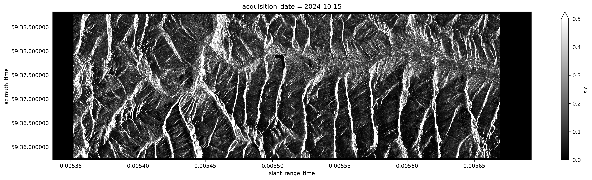
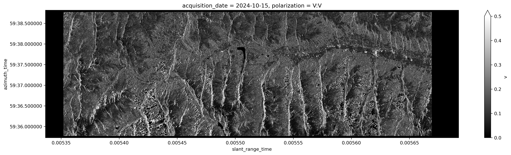

.. _gamma_flattening:

Gamma-flattening
'''''''''''''''''''''

Overview
--------
The objective of the :math:`\gamma`-flattening step is to flatten :math:`CSLC` by applying the 
Area Normalization Factor (:math:`ANF`).  
Depending on the processing parameters, the output of this step can be either the flattened CSLC intensity 
product or the flattened CSLC complex product.

Inputs
-------

- :math:`ANF`: Area Normalization Factor  
- :math:`CSLC`: Coregistered Single Look Complex image  

Outputs
--------

- :math:`\gamma^0_r`: Flattened CSLC intensity product  
- :math:`CSLC_{flatten}`: Flattened CSLC complex product  

Processing parameters
---------------------

It is possible to select whether to compute the complex flattened CSLC product, or only the intensity 
(real-valued) of the flattened CSLC product.

Algorithm
---------

The first step consists in extracting the real and imaginary parts of the input CSLC image. Considering the calibration 
procedure in :ref:`Amplitude calibration <amplitude_calibration>`, :math:`\beta^0` is the squared modulus of the CSLC product:

.. math::
   :label: eq_CSLC_module

   \beta_0 = \left| CSLC \right |^2 = \operatorname{Re}{(CSLC)}^2 + \operatorname{Im}{(CSLC)}^2

If only the intensity of the CSLC product is requested, the :math:`\gamma`-flattening step computes 
the :math:`\gamma^0_r` intensity image in radar geometry.

This step, considering the preliminary evaluation of :math:`ANF` by :ref:`Radar rasterization <radar_rasterization>`, 
is straightforward, since :math:`\gamma^0_r` is obtained simply by rescaling :math:`\beta^0` using :math:`ANF`:

.. math::
   :label: eq_gamma_flat

   \gamma^0_r = \frac{\beta^0}{ANF}

If instead the full complex flattened CSLC product is requested, :math:`CSLC_{flatten}` is obtained by dividing 
the CSLC complex product by the square root of :math:`ANF`:

.. math::
   :label: eq_CSLC_flat

   CSLC_{flatten} = \frac{CSLC}{\sqrt{\frac{ANF}{\beta^0}}} = CSLC \sqrt{\gamma^0_r}

An example of SAR Sentinel-1 image intensity, corresponding to a single burst in radar geometry, 
is shown in :numref:`intensity_iw1_92640_044_salzburg_orig`.

.. _intensity_iw1_92640_044_salzburg_orig_fig:

   Example of Sentinel-1 image intensity in :math:`\beta^0`, corresponding to a single burst.

The same example of Sentinel-1 image intensity after the compensation with :math:`ANF` 
is reported in :numref:`intensity_iw1_92640_044_salzburg`.

.. _intensity_iw1_92640_044_salzburg_fig:

   Example of Sentinel-1 image intensity in :math:`\gamma^0` in correspondence of a single burst.

Detailed variable description
-----------------------------

.. list-table:: Variable Description Table
   :widths: 25 50
   :header-rows: 1

   * - Property
     - Value
   * - Symbol
     - :math:`CSLC`
   * - Description
     - Coregistered SLC image  
   * - Purpose
     - Input
   * - Units
     - N/A
   * - Type
     - complex float array
   * - Dimensionality
     - (slant range, azimuth)
   * - Range of values
     - N/A
   * - Initial/default values
     - N/A
   * - Name in pseudo-code
     - N/A
   * - 
     -
   * - Symbol
     - :math:`ANF`
   * - Description
     - Area normalization factor in radar geometry
   * - Purpose
     - Input
   * - Units
     - N/A
   * - Type
     - float array
   * - Dimensionality
     - (slant range, azimuth)
   * - Range of values
     - :math:`[0,+\infty)`
   * - Initial/default values
     - N/A
   * - Name in pseudo-code
     - N/A
   * - 
     -
   * - Symbol
     - :math:`\gamma^0_{r}`
   * - Description
     - Flattened CSLC intensity product
   * - Purpose
     - Output
   * - Units
     - N/A
   * - Type
     - float array
   * - Dimensionality
     - (slant range, azimuth)
   * - Range of values
     - :math:`[0,+\infty)`
   * - Initial/default values
     - N/A
   * - Name in pseudo-code
     - N/A
   * - 
     -
   * - Symbol
     - :math:`CSLC_{flatten}`
   * - Description
     - Flattened CSLC product
   * - Purpose
     - Output
   * - Units
     - N/A
   * - Type
     - complex float array
   * - Dimensionality
     - (slant range, azimuth)
   * - Range of values
     - N/A
   * - Initial/default values
     - N/A
   * - Name in pseudo-code
     - N/A
   * - 
     -
   * - Symbol
     - :math:`\beta^0`
   * - Description
     - Slant range backscatter coefficient
   * - Purpose
     - Internal
   * - Units
     - N/A
   * - Type
     - float array
   * - Dimensionality
     - (slant range, azimuth)
   * - Range of values
     - :math:`[0,+\infty)`
   * - Initial/default values
     - N/A
   * - Name in pseudo-code
     - N/A

     