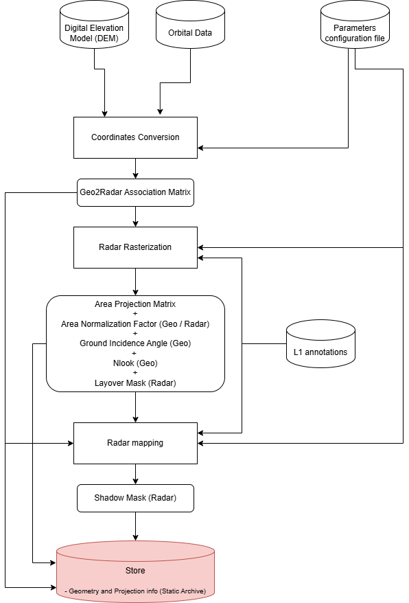

.. Copyright 2023 European Union

   Licensed under the Apache License, Version 2.0 (the "License");
   you may not use this file except in compliance with the License.
   You may obtain a copy of the License at

     http://www.apache.org/licenses/LICENSE-2.0

   Unless required by applicable law or agreed to in writing, software
   distributed under the License is distributed on an "AS IS" BASIS,
   WITHOUT WARRANTIES OR CONDITIONS OF ANY KIND, either express or implied.
   See the License for the specific language governing permissions and
   limitations under the License.

.. _Reference_Geometry_Products:

Reference Geometry
------------------------

The *Reference Geometry* unit generates geometric information necessary for other processing units to generate ARD products.  
The *Reference Geometry* process is executed once for the reference image, following the processing flow shown in :numref:`SNT-1_ref_geom_diagram`.  
Key steps of the *Reference Geometry* unit are:

- :ref:`Coordinate conversion <coordinate_conversion>`: Converts ground coordinates to radar coordinates.
- :ref:`Radar rasterization <radar_rasterization>`: Computes the area projection matrix linking ground and radar coordinates, the area normalization factor (ANF in radar coordinates), and the ground incidence angle.
- :ref:`Radar mapping <radar_mapping>`: Maps variables from ground to radar coordinates, specifically providing layover and shadow masks.

.. _ref_geom_chain_figure:

   *Reference Geometry* flow diagram.
