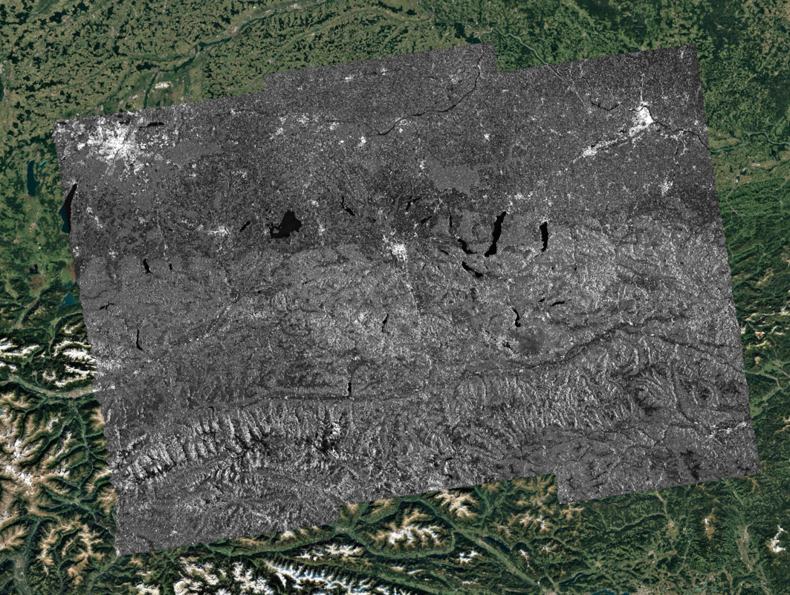
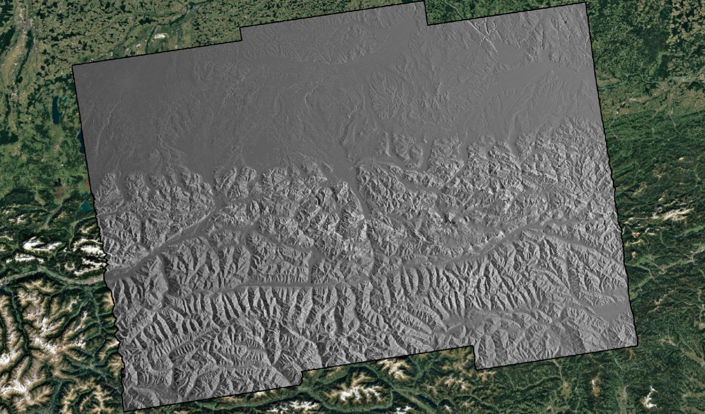
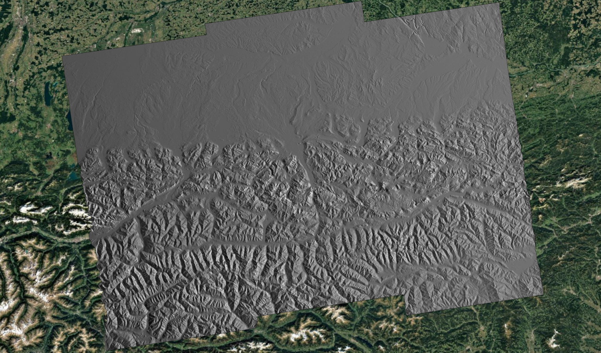

.. _mosaicking:

Mosaic
~~~~~~~~~~

Overview
---------

The *Mosaicking Unit* generates homogeneous maps fusing all the layers of the input burst-based NRB products.

Inputs
------
*Mosaic* tool requires the following inputs:

- :math:`\gamma^0_i, \forall i \in \{1,...,N\}`: Burst-projected NRB products, obtained from images with the same Data Take ID  
- :math:`\theta_i, \forall i \in \{1,...,N\}`: Burst-projected local incidence angle, obtained from images with the same Data Take ID  
- :math:`n_i, \forall i \in \{1,...,N\}`: Burst-projected Number of looks associated with each burst-based NRB product  
- :math:`m^l_i, \forall i \in \{1,...,N\}`: Burst-projected Layover masks
- :math:`m^s_i, \forall i \in \{1,...,N\}`: Burst-projected Shadow masks

Outputs
-------
The *Mosaic* tool provides the following output:

- :math:`\gamma^0_{mosaic}`: Geographic tiles of mosaicked NRB map
- :math:`\theta_{mosaic}`: Geographic tiles of mosaicked local incidence angle map
- :math:`n_mosaic`: Geographic tiles of mosaicked Number of looks
- :math:`m^l_mosaic`: Geographic tiles of mosaicked layover mask
- :math:`m^s_mosaic`: Geographic tiles of mosaicked shadow mask

Algorithms
----------

The modules of the projected NRB product :math:`\gamma^0` in correspondence with each burst are already calibrated and geocoded using the best available information.  
The overlapping areas between bursts or strips are used to obtain seamless mosaicked images.  
Two possible approaches can be used to mosaic data:

- exploit the overlapping area between bursts or subswaths, indexed as :math:`i=1,2,...,N`, averaging values according to the number of looks :math:`n`, as computed in :ref:`Area based projection algorithm <radar_rasterization>`;
- select the points accordingly to the distance with respect to the center of the burst. 

The reliability associated with each resolution cell of each input map is provided by the number of looks :math:`n`, as computed in :ref:`Area based projection algorithm <radar_rasterization>`.  
To obtain a seamless mosaic, a scaling function :math:`w` can be applied considering the distance from the border of each input image.  
The speed of the decay function is a configuration parameter.  
The weight function in correspondence with each image :math:`i` is:

.. math::
   :label: mosaic_weight

   W_i = n_i * w_i , \forall i \in \{1,...,N\}

:eq:`mosaic_weight`

After the alignment of all input projected NRB, :math:`\gamma^0_i` and weight images, the mosaic is obtained as:

.. math::
   :label: mosaic_mosaic

   \gamma^0_{mosaic} = \frac{\sum_{i=1}^{N}{W_i \gamma^0_i}}{\sum_{i=1}^{N}{W_i}}

:eq:`mosaic_mosaic`

The following figure shows an example of a mosaicked :math:`\gamma^0` map in VV polarization superimposed onto an optical image from Google Maps.  
The transition between different bursts is smooth, and the mosaic is homogeneous and continuous.

.. _NRB_Mosaicking_nrb_figure:

   Mosaic of :math:`\gamma^0` in VV polarization, superimposed onto an optical image from Google Maps.

The layover and shadow masks are also mosaicked summing the boolean values:

.. math::
   :label: mosaic_masks

   m^l_{mosaic} = \sum_{i=1}^{N}{m^l_i}\\
   m^s_{mosaic} = \sum_{i=1}^{N}{m^s_i}

:eq:`mosaic_masks`

The mosaiked masks are then applied to the geocoded :math:`\gamma^0_{mosaic}` product to mask out artifacts caused by geometric distortions.

Similarly, the local incidence angle map :math:`\theta_{mosaic}` is obtained as:

.. math::
   :label: mosaic_mosaic_theta

   \theta_{mosaic} = \frac{\sum_{i=1}^{N}{W_i \theta_i}}{\sum_{i=1}^{N}{W_i}}

:eq:`mosaic_mosaic_theta`

The following figure shows an example of a mosaicked local incidence angle map.  
The local incidence angle is homogeneous and continuous.  
In fact, it does not depend on real SAR data but is simulated using the DEM and orbital data.

.. _NRB_Mosaicking_theta_figure:

   Mosaic of the local incidence angle, superimposed onto an optical image from Google Maps.
   
The new reliability index associated with the mosaic is given by the sum of the number of looks associated with each cell:

.. math::
   :label: mosaic_mosaic_nlooks

   n_{mosaic} = \sum_{i=1}^{N}{n_i}

:eq:`mosaic_mosaic_nlooks`

The following figure shows an example of a mosaicked nlook map.  
Brighter pixels correspond to a higher number of looks, while darker pixels correspond to a lower number of looks.  
The number of looks varies according to terrain slopes, and in correspondence with overlapping areas between bursts, the number increases as more pixels are averaged.

.. _NRB_Mosaicking_nlook_figure:

   Mosaic of nlooks. Brighter pixels correspond to the overlapping area between bursts, where the number of averaged pixels is higher.