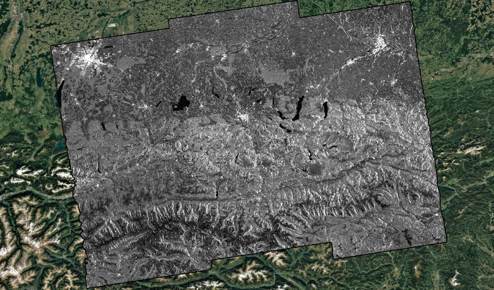
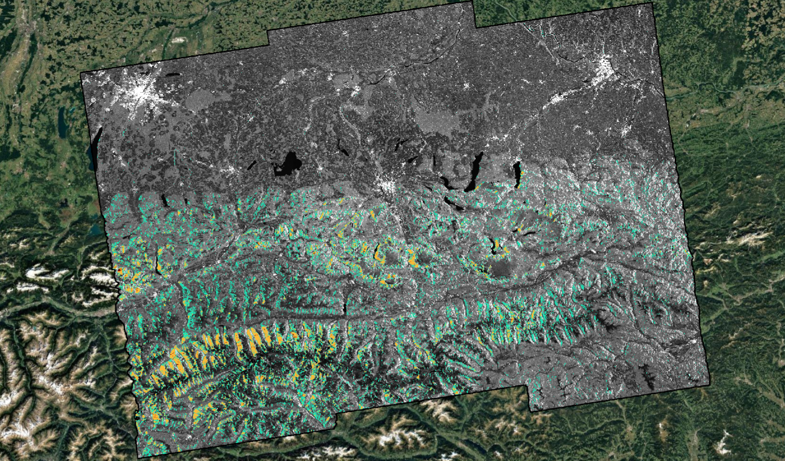
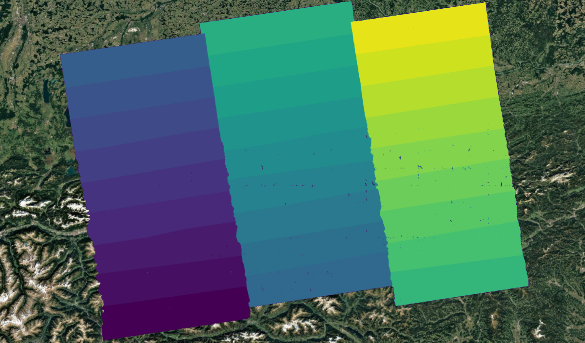

.. _mosaicking:

Mosaic
~~~~~~~~~~

Overview
---------

The *Mosaicking Unit* generates homogeneous maps fusing all the layers of the input burst-based NRB products.

Inputs
------
*Mosaic* tool requires the following inputs:

- :math:`\gamma^0_i, \forall i \in \{1,...,N\}`: Burst-projected NRB products, obtained from images with the same Data Take ID  
- :math:`\theta_i, \forall i \in \{1,...,N\}`: Burst-projected local incidence angle, obtained from images with the same Data Take ID  
- :math:`n_i, \forall i \in \{1,...,N\}`: Burst-projected Number of looks associated with each burst-based NRB product  
- :math:`m^l_i, \forall i \in \{1,...,N\}`: Burst-projected Layover masks
- :math:`m^s_i, \forall i \in \{1,...,N\}`: Burst-projected Shadow masks

Outputs
-------
The *Mosaic* tool provides the following output:

- :math:`\gamma^0_{mosaic}`: Geographic tiles of mosaicked NRB map
- :math:`\theta_{mosaic}`: Geographic tiles of mosaicked local incidence angle map
- :math:`n_{mosaic}`: Geographic tiles of mosaicked Number of looks
- :math:`m^l_{mosaic}`: Geographic tiles of mosaicked layover mask
- :math:`m^s_{mosaic}`: Geographic tiles of mosaicked shadow mask
- :math:`id_{mosaic}`: id of the burst used to extract the information 

Algorithms
----------

The modules of the projected NRB product :math:`\gamma^0`, corresponding to each burst, are already calibrated and geocoded using the best available information.  
Points on the output mosaic are selected according to their distance from the center of the burst.  
As the data are calibrated, this enables the generation of seamless mosaicked images.

The reliability associated with each resolution cell of each input map is provided by the number of looks :math:`n`, as computed in :ref:`Area based projection algorithm <radar_rasterization>`.

After aligning all input projected NRB variables listed above, the bursts to be mosaicked are sequentially analyzed following these steps:

- compute the distance from the burst center  
- for points where this distance is smaller than the one already stored:  
   - replace all variables with those of the current burst  
   - update the stored distance for the modified points  
   - save the burst ID for the updated points  

The following figure shows an example of a mosaicked :math:`\gamma^0` map in VH polarization, superimposed onto an optical image from Google Maps.  
The transition between bursts is smooth, and the mosaic appears homogeneous and continuous.

.. _NRB_Mosaicking_nrb_figure:

   Mosaic of :math:`\gamma^0` in VV polarization, superimposed onto an optical image from Google Maps.

The next figure shows the associated layover/shadow mask. Colors represent:

- cyan: layover  
- orange: shadow  
- red: layover + shadow  

.. _NRB_Mosaicking_mask_figure:

   Mosaic of the mask. Cyan corresponds to layover, orange to shadow, and red to both.

The following figure presents a mosaicked local incidence angle map.  
The angle is homogeneous and continuous, as it is not derived from SAR data but simulated using the DEM and orbital information.

.. _NRB_Mosaicking_theta_figure:
.. figure:: images/local_incidence_angle_track_044_s1ard.png
   :name: NRB_Mosaicking_lia
   :width: 600
   :align: center

   Mosaic of the local incidence angle, superimposed onto an optical image from Google Maps.

The new reliability index associated with the mosaic is represented by the number of looks per cell.

The next figure shows a mosaicked nlook map.  
Brighter pixels indicate a higher number of looks, while darker pixels represent lower values.  
This variability mainly reflects terrain slope.

.. _NRB_Mosaicking_nlook_figure:
.. figure:: images/nlook_track_044_s1ard.png
   :name: NRB_Mosaicking_nlook
   :width: 600
   :align: center

   Mosaic of nlooks. Brighter areas correspond to overlapping burst regions with a higher number of averaged pixels.

Each point in the mosaic is tagged with the ID of the source burst from which its data originates.  
A representative map of burst IDs is shown in the following figure.

.. _NRB_Mosaicking_id_figure:

   Mosaic of burst indices, identifying the source burst for each point in the mosaic.

Finally, the mosaicked data are tiled according to the modified Sentinel-2 MGRS grid.