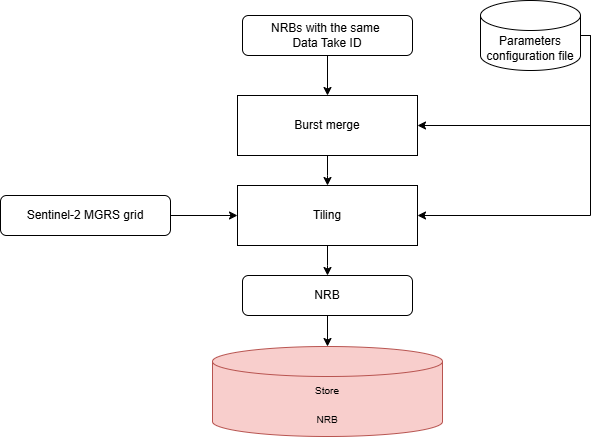

.. Copyright 2023 European Union

   Licensed under the Apache License, Version 2.0 (the "License");  
   you may not use this file except in compliance with the License.  
   You may obtain a copy of the License at  

     http://www.apache.org/licenses/LICENSE-2.0  

   Unless required by applicable law or agreed to in writing, software  
   distributed under the License is distributed on an "AS IS" BASIS,  
   WITHOUT WARRANTIES OR CONDITIONS OF ANY KIND, either express or implied.  
   See the License for the specific language governing permissions and  
   limitations under the License.  

.. _mosaicking:  

Mosaic
~~~~~~~~~~~~~~~~~~~~

The *Geocoding unit* creates internal burst-projected NRB products, having as image module the :math:`\gamma^0` map.  

The *Mosaicking* unit consists of two main modules:  

- :ref:`burst merge <burst_merge>`: Used to generate a homogeneous and continuous NRB product by fusing all the available projected NRB :math:`\gamma^0` maps, obtained by processing several bursts or strips acquired with the same Data Take ID.  

- :ref:`tiling <tiling>`: The NRB product is tiled in blocks with dimensions and spacing as defined for the Sentinel-2 tiles.  

The :numref:`mosaic_unit_schema` shows a simplified schema of this functionality, with the necessary inputs and the provided outputs.  

.. _mosaic_unit_schema_figure:  

   Diagram of *Mosaicking unit*.  
