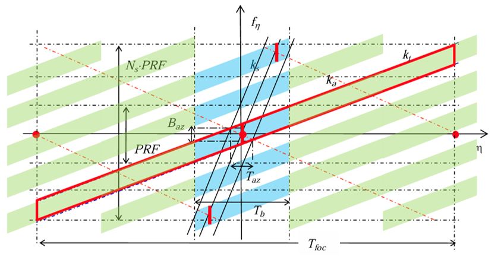
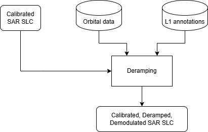

.. _phase_deramping:

Phase deramping
~~~~~~~~~~~~~~~~~~~~~~~~

Overview
--------
The Sentinel-1 TOPS acquisition mode features RAW and SLC data with linear frequency modulation over time.

The deramping procedure removes this linear frequency modulation (also called deramping), which is necessary for
performing basic operations like interpolation/resampling of the data, often used in interferometric processing chains. In addition, the deramping procedure demodulates the signal to report
its spectrum in baseband.

The reramping step is similar to the deramping procedure, except for the sign of the function used for deramping-demodulation.

This document defines the procedure for performing the deramping-demodulation of Sentinel-1 TOPS IW, EW, and SM Level-1 SLC products,
as well as the complementary procedure (reramping/remodulation).
In the case of IW and EW modes, the deramping function contains both the steering and Doppler centroid components, whereas in SM acquisitions, only the Doppler component is compensated.

The term "deramping" here indicates both the deramping and demodulation procedures.
Similarly, "reramping" includes the remodulation step.

Inputs
------

The *phase deramping* tool requires the following inputs:

- :math:`annot`: L1 Image annotations
- :math:`slc`: Calibrated L1 data

Outputs
-------
The *phase deramping* tool produces complex L1 data with unaltered amplitude and modified phase,  
resulting in a baseband signal in the case of *deramping* or a modulated signal in the case of *reramping*.

Processing parameters
---------------------

No processing parameters are needed for this operation.

Algorithm
---------
The *phase deramping* procedure must account for both TOPSAR modulation (for IW and EW acquisition modes)  
and the presence of a Doppler centroid.  
The mechanism to reconstruct the TOPSAR modulation is extensively explained in :cite:`RDTOPSDEMOD`.  
The Time-Frequency diagram of TOPS SLC burst acquisition, for simplicity, is shown in :numref:`TOPS_time_freq_diagram`.

.. _TOPS_time_freq_diagram_figure:

   Linear variation of the Doppler frequency across azimuth time within a burst (in red).  
   The representation assumes a Doppler centroid frequency :math:`f_{\eta c}` of 0 Hz for simplicity.  
   Credits: :cite:`RDTOPSDEMOD`. 

The Doppler centroid is provided in a Look-Up Table (LUT).  
Starting from this, a polynomial interpolator can be used to reconstruct the phase function over all points of interest :math:`(t_a,t_r)`.  

:numref:`deramping_schema` presents a simplified schema of this step.

.. _deramping_schema_figure:

   Diagram of image deramping processing step.

Let :math:`\phi_{demod} (t_a,t_r)` be the total demodulation phase. The final demodulated SLC :math:`slc' (t_a,t_r)` is:

.. math::
   :label: eq_deramping

   slc' (t_a,t_r ) = slc (t_a,t_r ) e^{-j\phi_{demod} (t_a,t_r ) }

Phase reramping is the inverse operation of deramping, achieved simply by inverting the sign of the phase in the complex exponent.

Detailed variable description
-----------------------------

.. list-table:: Variable Description Table
   :widths: 25 50
   :header-rows: 1

   * - Property
     - Value
   * - Symbol
     - :math:`slc`
   * - Description
     - Input SLC image, expressed in Digital Number (DN) or calibrated
   * - Purpose
     - Input
   * - Units
     - N/A
   * - Type
     - complex array
   * - Dimensionality
     - (range, azimuth)
   * - Range of values
     - N/A
   * - Initial/default values
     - N/A
   * - Name in pseudo-code
     - N/A
   * - 
     -
   * - Symbol
     - :math:`\phi_{demod}`
   * - Description
     - Total demodulation phase polynomial coefficients' matrix
   * - Purpose
     - Input
   * - Units
     - N/A
   * - Type
     - float matrix
   * - Dimensionality
     - (degree in range, degree in azimuth)
   * - Range of values
     - N/A
   * - Initial/default values
     - N/A
   * - Name in pseudo-code
     - N/A
   * - 
     -
   * - Symbol
     - :math:`slc'`
   * - Description
     - Output demodulated SLC image, expressed in Digital Number (DN) or calibrated depending on the input image
   * - Purpose
     - Output
   * - Units
     - N/A
   * - Type
     - complex array
   * - Dimensionality
     - (range, azimuth)
   * - Range of values
     - N/A
   * - Initial/default values
     - N/A
   * - Name in pseudo-code
     - N/A
   * - 
     -
   * - Symbol
     - :math:`t_a`
   * - Description
     - azimuth absolute coordinate
   * - Purpose
     - Internal
   * - Units
     - nanoseconds
   * - Type
     - datetime64[ns]
   * - Dimensionality
     - (azimuth)
   * - Range of values
     - N/A
   * - Initial/default values
     - N/A
   * - Name in pseudo-code
     - N/A
   * - 
     -
   * - Symbol
     - :math:`t_r`
   * - Description
     - range coordinate
   * - Purpose
     - Internal
   * - Units
     - seconds
   * - Type
     - float
   * - Dimensionality
     - (range)
   * - Range of values
     - :math:`\ge 0`
   * - Initial/default values
     - N/A
   * - Name in pseudo-code
     - N/A
   * - 
     -
