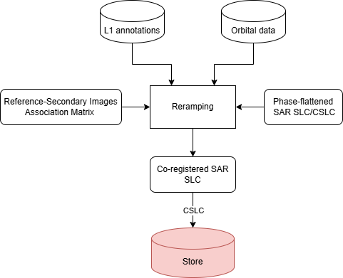

.. _phase_reramping:

Phase reramping
~~~~~~~~~~~~~~~~~~~~~~~~

Overview
--------
The Sentinel-1 TOPS acquisition mode features RAW and SLC data with linear frequency modulation over time.
The reramping procedure restores the original linear frequency modulation after the image resampling step. This procedure modulates the signal to restore the original image spectrum.
Reramping uses the same phase model described in the deramping procedure, except that it must be computed in correspondence with the resampled coordinates.
This document defines the procedure for performing the reramping modulation of Sentinel-1 TOPS IW, EW, and SM Level-1 SLC products.

:numref:`reramping_diagram_schema` presents a schematic overview of this process:

.. _reramping_diagram_schema_figure:

   Diagram of image reramping processing step. The output is stored in the *EOProductStorage*.

Inputs
------

The *phase reramping* tool requires the following inputs:

- :math:`annot`: L1 Image annotations
- :math:`slc`: Calibrated L1 data

Outputs
-------
The *phase reramping* tool produces complex L1 data with unaltered amplitude and modified phase,
resulting in a modulated signal.

Processing parameters
---------------------

No processing parameters are needed for this operation.

Algorithm
---------
The *phase reramping* process must account for both TOPSAR modulation (for IW and EW acquisition modes)
and the presence of a Doppler centroid.
The mechanism to reconstruct the TOPSAR modulation is extensively explained in :cite:`RDTOPSDEMOD`.  

The Doppler centroid is provided in a Look-Up Table (LUT).  
Starting from this, a polynomial interpolator can be used to reconstruct the phase function over all points of interest :math:`(t_a,t_r)`.  
Notice that in this case, the model must be reconstructed in different coordinates: the azimuth :math:`t_{a_s}` and slant range :math:`t_{r_s}` of the secondary image,
aligned with the output grid (reference image).  

Let :math:`\phi_{demod} (t_{a_s},t_{r_s})` be the total demodulation phase. The final demodulated SLC :math:`slc' (t_a,t_r)` is:

.. math::
   :label: eq_reramping

   slc' (t_a,t_r) = slc (t_a,t_r) e^{j\phi_{demod} (t_{a_s},t_{r_s}) }

Detailed variable description
-----------------------------

.. list-table:: Variable Description Table
   :widths: 25 50
   :header-rows: 1

   * - Property
     - Value
   * - Symbol
     - :math:`slc`
   * - Description
     - Input demodulated SLC image, expressed in Digital Number (DN) or calibrated
   * - Purpose
     - Input
   * - Units
     - N/A
   * - Type
     - complex array
   * - Dimensionality
     - (range, azimuth)
   * - Range of values
     - N/A
   * - Initial/default values
     - N/A
   * - Name in pseudo-code
     - N/A
   * - 
     -
   * - Symbol
     - :math:`\phi_{demod}`
   * - Description
     - Total demodulation phase polynomial coefficients' matrix
   * - Purpose
     - Input
   * - Units
     - N/A
   * - Type
     - float matrix
   * - Dimensionality
     - (degree in range, degree in azimuth)
   * - Range of values
     - N/A
   * - Initial/default values
     - N/A
   * - Name in pseudo-code
     - N/A
   * - 
     -
   * - Symbol
     - :math:`slc'`
   * - Description
     - Output remodulated SLC image, expressed in Digital Number (DN) or calibrated depending on the input image
   * - Purpose
     - Output
   * - Units
     - N/A
   * - Type
     - complex array
   * - Dimensionality
     - (range, azimuth)
   * - Range of values
     - N/A
   * - Initial/default values
     - N/A
   * - Name in pseudo-code
     - N/A
   * - 
     -
   * - Symbol
     - :math:`t_a`
   * - Description
     - azimuth absolute coordinate (reference image)
   * - Purpose
     - Internal
   * - Units
     - nanoseconds
   * - Type
     - datetime64[ns]
   * - Dimensionality
     - (azimuth)
   * - Range of values
     - N/A
   * - Initial/default values
     - N/A
   * - Name in pseudo-code
     - N/A
   * - 
     -
   * - Symbol
     - :math:`t_r`
   * - Description
     - range coordinate (reference image)
   * - Purpose
     - Internal
   * - Units
     - seconds
   * - Type
     - float
   * - Dimensionality
     - (range)
   * - Range of values
     - :math:`\ge 0`
   * - Initial/default values
     - N/A
   * - Name in pseudo-code
     - N/A
   * - 
     -
   * - Symbol
     - :math:`t_{a_s}`
   * - Description
     - azimuth absolute coordinate (secondary image)
   * - Purpose
     - Internal
   * - Units
     - nanoseconds
   * - Type
     - datetime64[ns]
   * - Dimensionality
     - (azimuth)
   * - Range of values
     - N/A
   * - Initial/default values
     - N/A
   * - Name in pseudo-code
     - N/A
   * - 
     -
   * - Symbol
     - :math:`t_{r_s}`
   * - Description
     - range coordinate (secondary image)
   * - Purpose
     - Internal
   * - Units
     - seconds
   * - Type
     - float
   * - Dimensionality
     - (range)
   * - Range of values
     - :math:`\ge 0`
   * - Initial/default values
     - N/A
   * - Name in pseudo-code
     - N/A
   * - 
     -
