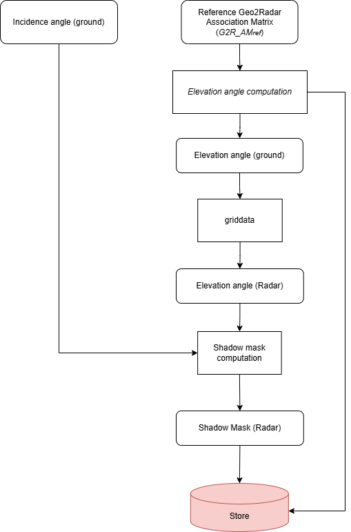
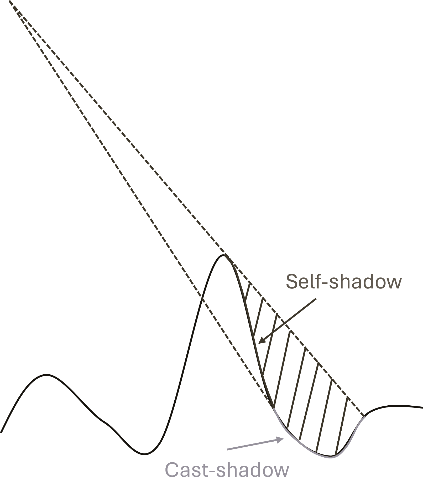

.. _radar_mapping:

Radar Mapping
~~~~~~~~~~~~~~

Overview
'''''''''''
The objective of the *Radar Mapping* tool is to compute some variables in correspondence with the DEM grid and then project them into radar coordinates (slant range, azimuth).  
Additionally, the shadow mask in radar geometry is computed. The output grid is defined by the reference image.  
The variables to be computed and projected are:

  - Elevation angle: :math:`\zeta`
  - Ground incidence angle: :math:`\theta_i`

The diagram of the *Radar Mapping* step is shown in :numref:`radar_mapping_schema_figure`.  
The conversion into radar coordinates of :math:`\zeta` and :math:`\theta` is necessary for the evaluation of the shadow mask, considering both self-shadow and cast-shadow.

.. _radar_mapping_schema_figure:

   Diagram of *Radar Mapping* step.

Inputs
''''''
The *Radar Mapping* tool requires the following inputs:

  - :math:`G2RAM`: Geo2Radar Association Matrix (Reference azimuth, slant range, line of sight, and height).
  - :math:`\theta_i`: Local incidence angle on the output geographic grid.
  - Parameters configuration file: Type of geographic grid (reference or complementary Geogrid).

Outputs
'''''''
*Radar Mapping* tool provides the following outputs:

  - :math:`Z`: Elevation angle in the radar reference grid.
  - :math:`\Theta_i`: Local incidence angle in the radar reference grid.
  - :math:`shadow`: Shadow mask in radar reference grid.

Algorithms
''''''''''
The resampling of variables from the geographic grid into the radar grid requires the use of interpolators capable of handling irregularly sampled input data.  
The adopted solution is based on linear interpolation on triangles, described in :ref:`Sparse grid to regular grid image interpolation <sparse_grid_to_regular_grid_image_interpolation_linear>`.

The shadow mask is obtained by analyzing the evolution of the elevation angle in the slant range direction and the values of the ground incidence angle.

A typical example of the elevation angle's evolution in the slant range direction is shown in :numref:`elevation_angle_example_figure`.

.. _elevation_angle_example_figure:

   Example of the evolution of the elevation angle in the slant range direction.  
   Cast shadow is present when the elevation angle is not monotonic, while self-shadow is present when the ground incidence angle is negative.

The elevation angle :math:`\zeta` is defined as the angle between the range distance vector :math:`\vec{r}` and the satellite position vector :math:`\vec{p}`:

.. math::
   :label: eq_elevation_angle

   \zeta = \arccos \left( \frac{\vec{r} \cdot \vec{p}}{|\vec{r}| |\vec{p}|} \right)

Given the angles :math:`\zeta` and :math:`\theta_i` in ground geometry, it is possible to compute the equivalent :math:`Z` and :math:`\Theta_i` in radar geometry  
by interpolating according to the method described in :ref:`Sparse grid to regular grid image interpolation <sparse_grid_to_regular_grid_image_interpolation_linear>`.

In the absence of shadow, the elevation angle should be a monotonic function in the slant range direction, and the cosine of the ground incidence angle should be positive.  
Any violation of this condition implies the presence of shadow.  
Let :math:`B_{i}` be the buffer of points in the range direction before the point :math:`i` for a given azimuth row and let :math:`P` be the set of points in Radar grid. 
The shadow mask is defined as follows:

.. math::
   :label: eq_shadow_mask

   shadow_i = \left( \cos{\Theta_{i}} < 0 \right) \,\text{OR}\, \left( Z_i > \max_{j \in B_i}{Z_j} \right), \forall{ i \in P}

Detailed variables description
'''''''''''''''''''''''''''''

.. list-table:: Variable Description Table
   :widths: 25 50
   :header-rows: 1

   * - Property
     - Value
   * - Symbol
     - :math:`G2RAM`
   * - Description
     - Reference Geo2Radar Association matrix (containing, for each ground cell: azimuth, slant range, distance to satellite, line of sight, height)
   * - Purpose
     - Input
   * - Units
     - N/A
   * - Type
     - float/datetime64[ns] array
   * - Dimensionality
     - (x, y)
   * - Range of values
     - N/A
   * - Initial/default values
     - N/A
   * - Name in pseudo-code
     - N/A
   * - 
     -
   * - Symbol
     - :math:`\theta_i`
   * - Description
     - Local incidence angle on the geographic grid
   * - Purpose
     - Input
   * - Units
     - radians
   * - Type
     - float array
   * - Dimensionality
     - (x, y)
   * - Range of values
     - N/A
   * - Initial/default values
     - N/A
   * - Name in pseudo-code
     - N/A
   * - 
     -
   * - Symbol
     - :math:`Z`
   * - Description
     - Elevation angle on the reference radar grid
   * - Purpose
     - Output
   * - Units
     - radians
   * - Type
     - float array
   * - Dimensionality
     - (slant range, azimuth)
   * - Range of values
     - N/A
   * - Initial/default values
     - N/A
   * - Name in pseudo-code
     - N/A
   * - 
     -
   * - Symbol
     - :math:`\Theta_i`
   * - Description
     - Local incidence angle on the reference radar grid
   * - Purpose
     - Output
   * - Units
     - radians
   * - Type
     - float array
   * - Dimensionality
     - (slant range, azimuth)
   * - Range of values
     - N/A
   * - Initial/default values
     - N/A
   * - Name in pseudo-code
     - N/A
   * - 
     -
   * - Symbol
     - :math:`shadow`
   * - Description
     - Shadow mask in radar reference grid
   * - Purpose
     - Output
   * - Units
     - N/A
   * - Type
     - bool array
   * - Dimensionality
     - (slant range, azimuth)
   * - Range of values
     - :math:`\{0, 1\}`
   * - Initial/default values
     - N/A
   * - Name in pseudo-code
     - N/A
   * - 
     -
   * - Symbol
     - :math:`\vec{p}`
   * - Description
     - Satellite position
   * - Purpose
     - Input
   * - Units
     - N/A
   * - Type
     - float array
   * - Dimensionality
     - (axis)
   * - Range of values
     - N/A
   * - Initial/default values
     - N/A
   * - Name in pseudo-code
     - N/A
   * - 
     -
   * - Symbol
     - :math:`\vec{r}`
   * - Description
     - Range vector connecting the satellite and the target on the ground
   * - Purpose
     - Internal
   * - Units
     - N/A
   * - Type
     - float array
   * - Dimensionality
     - (x,y)
   * - Range of values
     - N/A
   * - Initial/default values
     - N/A
   * - Name in pseudo-code
     - N/A
   * - 
     -
   * - Symbol
     - :math:`\zeta`
   * - Description
     - Elevation angle on the geographic grid
   * - Purpose
     - Internal
   * - Units
     - radians
   * - Type
     - float array
   * - Dimensionality
     - (x,y)
   * - Range of values
     - N/A
   * - Initial/default values
     - N/A
   * - Name in pseudo-code
     - N/A
   * - 
     -
   * - Symbol
     - :math:`B_i`
   * - Description
     - Buffer of points in the range direction before the point :math:`i` for a given azimuth row
   * - Purpose
     - Internal
   * - Units
     - N/A
   * - Type
     - N/A
   * - Dimensionality
     - N/A
   * - Range of values
     - N/A
   * - Initial/default values
     - N/A
   * - Name in pseudo-code
     - N/A
   * - 
     -