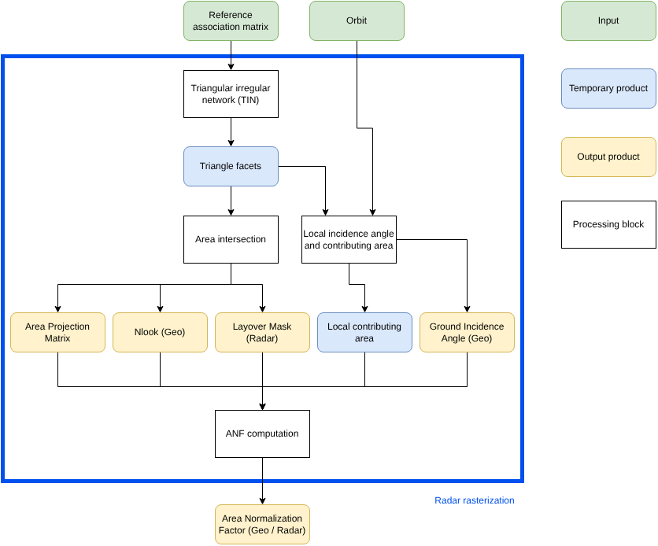
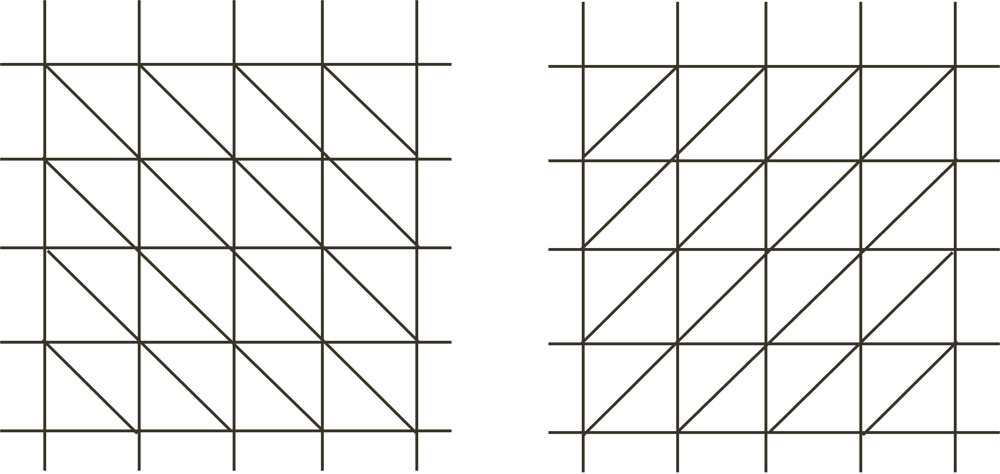
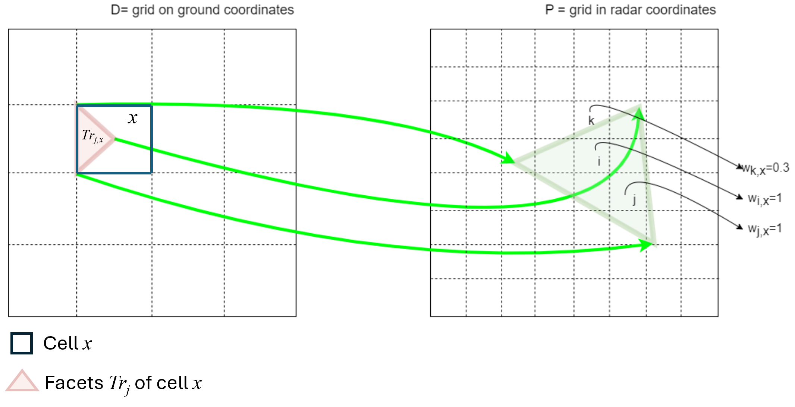
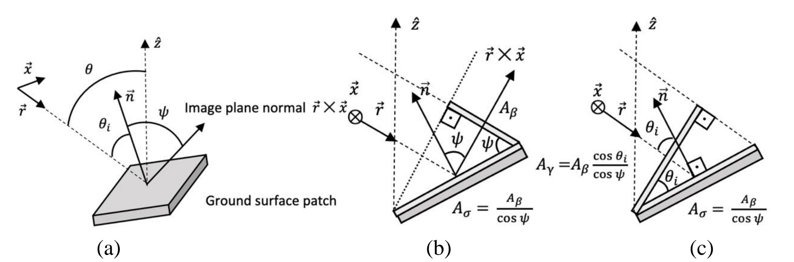

.. _radar_rasterization:

Radar Rasterization
~~~~~~~~~~~~~~~~~~~~~~
The main scope of this tool is to compute the slope compensation with the area normalization factor (ANF)  
necessary to convert the radar backscatter coefficient or the beta-naught (:math:`\beta^0`),  
to gamma-naught (:math:`\gamma^0`).  
The procedure also extracts the area projection matrix (for geocoding with the area-based projection algorithm),  
the local incidence angle, the number of looks in ground coordinates, and the layover mask in radar geometry.

.. _ABP_description:

Overview
'''''''''''
The *Radar rasterization* tool includes the following operations:

     - :ref:`Triangular Irregular Network <Triangular_Irregular_Network>`: Extraction of the facets of the DEM.
     - :ref:`Area intersection <area_intersection>`: Computation of the Area Projection Matrix (APM) linking each geographic cell with the corresponding radar cells.
     - :ref:`Local incidence angle and contributing area <local_incidence_angle_and_contributing_area>`: Computation of the local incidence angle and the local contributing area for each geographic cell.
     - :ref:`ANF computation <ANF_computation>`: Computation of the area normalization factor (ANF) to compensate backscattering for terrain slope.

The following figure is a simple schema for the steps necessary to obtain the intermediate products of the *Radar rasterization* tool.

.. _area_based_proj_schema_figure:

   Schema of Radar rasterization steps.

The algorithms for slope compensation and the projection matrix described below are  
based on :cite:`Shiroma2022`. The Shiroma algorithm provides a solution to  
the lack of bijective correspondence between ground and radar coordinates,  
i.e., the two coordinate systems map "many-to-one" and "one-to-many" between them.  
To achieve this, the reference surface is first computed over the geographical  
grid and then accumulated over radar coordinates. If multiple pixels of the geographical grid  
fall into a single radar pixel, all associated areas corresponding to the mapped pixels will be  
considered for the derivation of the radar sample correction factor.

In addition, the Shiroma algorithm, using the slant-range projection with the area projection algorithms,  
fills all spaces covered by the projected area elements without leaving gaps,  
reducing or eliminating the need for DEM oversampling, as required instead by the procedure proposed by  
:cite:`Small2011`.

In cases of stacks of CSLC images with orbital baselines of a few hundred meters, it is possible,  
according to :cite:`Navacchi2023`, to compute the ANF function and the weights of the AP algorithm  
only once for the reference virtual image and then use these weights for all secondary images.

.. _ABP_inputs:

Inputs
''''''  
The *Radar rasterization* tool requires the following inputs:

   - :math:`G2RAM_{ref}`: Reference Geo2Radar Association Matrix (Reference azimuth, slant range, line of sight, and height).
   - :math:`orb`: Orbital data, including satellite position, velocity and acceleration.
   - :math:`annot`: L1 Image annotations.

.. _ABP_outputs:

Outputs
'''''''  
The *Radar rasterization* tool provides the following outputs:

   - :math:`ANF`: Area Normalization Factor. For each radar cell, the ANF contains the normalization factor to be applied for obtaining the :math:`\gamma^0` coefficient.
   - :math:`w`: Area Projection Matrix (APM). The APM is the projection matrix necessary to evaluate the :math:`\gamma^0` coefficient in correspondence with each geographic cell.
   - :math:`nlook`: The equivalent number of looks associated with the geographic grid.
   - :math:`\theta_i`: The local incidence angles associated with the geographic grid.
   - :math:`layover`: Layover mask over the radar grid.

.. _ABP_algo:

Algorithms
''''''''''  
The core functionalities are based on the algorithm described in :cite:`Shiroma2022`  
and are able to derive the projection matrix for geocoding and the correction for terrain slope  
to provide radiometrically terrain-corrected images.  
The algorithm finds the correspondence between areas on the ground and areas on the radar image grid,  
weighting the radar backscatter according to the percentage of the covered pixel area.

Each algorithm indicated in :numref:`area_based_projection_schema` is described below.

.. _Triangular_Irregular_Network:

Triangular Irregular Network
^^^^^^^^^^^^^^^^^^^^^^^^^^^^^^  
The scope of this block is to represent the input DEM as a **Triangular Irregular Network (TIN)**.  
Since the DEM is regularly sampled, the triangulation is straightforward.  
To avoid preferences in triangle facet direction, two complementary triangulations are considered:  
given the vertices of each resolution cell of the DEM, four partially overlapping triangles can be extracted.  
The two complementary triangulations are shown in :numref:`triangulation_figure`.

.. _triangulation_figure:

   Two complementary triangulations of the regularly gridded input DEM.

The extracted triangles serve as the basis for the next steps of the algorithm and  
are used to represent the area elements in the geographic grid.

.. _area_intersection:

Area intersection
^^^^^^^^^^^^^^^^^^^^^^^^^^^^^^  
:numref:`area_ground_vs_radar_coords` represents the correspondence between areas in ground coordinates and radar coordinates.

.. _bck_area_ground_vs_radar_coords_figure:

   Schematic correspondence between areas in ground and radar coordinates.

The area-based projection algorithm associates each geographic cell with radar resolution cells.  
According to :numref:`area_ground_vs_radar_coords`, let us define:

   - :math:`i \in P` as a generic resolution cell of the SAR image :math:`S`.  
   - :math:`x \in D` as a cell of the output grid :math:`D` in ground coordinates (geogrid).  
   - :math:`M_{x}` as the set of radar resolution cells covering the cell :math:`x`.  
   - :math:`j \in J` as the indices of the triangles belonging to each ground cell :math:`x`, with :math:`J = \{1,2,3,4\}` for the two triangulations.  
   - :math:`\omega_{i,x}^{j}` as the portion of the radar resolution cell :math:`i` covered by the triangle with index :math:`j` of the ground cell :math:`x`.  
   - :math:`w_{i,x} = \frac{\sum_{j \in J} \omega_{i,x}^{j}}{2}` as the total portion of the radar resolution cell :math:`i` covered by the ground cell :math:`x`.

The weights :math:`w_{i,x}` are the percentage of the radar pixel area included in the projected cell :math:`x`, and are the basis for the computation of the Area Projection Matrix (APM).  
If the pixel :math:`i` is included in the projected triangle with index :math:`j` belonging to the cell :math:`x`, the corresponding weight is 1.

The sum of the elements of :math:`w_{i,x}` over all the radar resolution cells :math:`i \in P` corresponds to the number of radar cells covering the ground cell :math:`x`, which is equivalent to the number of looks :math:`nlook_x`:

.. math::
   :label: eq_nlooks_1
   
   nlook_{x} = \sum_{i \in M_x} w_{i,x}, \forall{x \in D}

Let :math:`layover_{i}` be the layover mask associated with the radar cell :math:`i \in P`.  
Let :math:`\omega_{i,x}^{j}` for :math:`j \in [1,2]`, and :math:`w_{i,x}^{j}` for :math:`j \in [3,4]` be the weights associated with the two triangulations.  
If the sum of the elements of :math:`w_{i,x}^{j}` over all triangle indices of one of the two triangulations is greater than 1, the corresponding radar resolution cell :math:`i \in P` is in layover.

.. math::
   :label: eq_layover_1
   
   layover_{i} = \left( \sum_{j \in [1,2]} \sum_{x \in D} \omega_{i,x}^{j} > 1 \right) \,\text{OR}\, \left( \sum_{j \in [3,4]}\sum_{x \in D} \omega_{i,x}^{j} > 1 \right), \forall{ i \in P}

.. _local_incidence_angle_and_contributing_area:

Local incidence angle and contributing area
^^^^^^^^^^^^^^^^^^^^^^^^^^^^^^^^^^^^^^^^^^^

To obtain the ANF, it is necessary to compute, for each facet and for each cell :math:`x \in D` of the output grid :math:`D`,  
the local contributing area for the derivation of the :math:`\gamma^0`.

.. _bck_coefficients_figure:

   Representation of the radar backscattering coefficients.  
   A 3-D view of acquisition geometry and ground area patch is in (a), while simplified 2-D views representing the reference relation between :math:`A_{\beta}`,  
   :math:`A_{\sigma}`, and :math:`A_{\gamma}` are in (b) and (c). :math:`\vec{x}` is the along-track  
   vector, :math:`\vec{r}` is the look vector, :math:`\vec{n}` is the ground surface normal,  
   :math:`\theta` is the ellipsoidal incidence angle, :math:`\theta_{i}` is the local-incidence angle,  
   and :math:`\psi` is the projection angle.  
   Credits: :cite:`Shiroma2022`.

The computation of the local contributing area requires the following steps:

- Compute the cosine of the local-incidence angle :math:`\cos{\theta_{i_x}}` (see :numref:`bck_coefficients_representation`) as the average of the cosine of the local-incidence angle over all triangles :math:`j \in J` associated with the cell :math:`x \in D`:

.. math::
    :label: eq_cosine

    \cos(\theta_{i_{x}})=\frac{1}{4} \sum_{j \in J} \vec{r}_x^j\cdot\vec{n}_x^j, \forall{x \in D}

- Measure the facet ground surface area as:

.. math::
    :label: eq_Asigma
   
    A_{\sigma_x} = \frac{1}{4} \sum_{j \in J} \lVert \vec{e}_{1_x}^j \times \vec{e}_{2_x}^j \rVert, \forall{x \in D}

where :math:`\vec{e}_1` and :math:`\vec{e}_2` are vectors representing two of the facet's edges.

- Scale the facet ground surface area :math:`A_{\sigma_x}` to the facet gamma-naught area :math:`A_{\gamma_x}` to obtain the local contributing area in ground geometry (see :numref:`bck_coefficients_representation`):

.. math::
    :label: eq_Asigma_scaled
   
    A_{\gamma_x} = A_{\sigma_x} \cos{\theta_{i_x}}, \forall{x \in D}

The local contributing area :math:`A_{\gamma_x}` is computed in correspondence of the reference geometry. In order to take into account the difference in the observation geometry, the area in :eq:`eq_Asigma_scaled` could be opportunely rescaled expanding in Taylor series up to the first order as a function of the difference in the incidence angle :math:`\delta \theta = B_{\perp} / R`.

.. math::
    :label: eq_Asigma_scaled_taylor
   
    A_{\gamma_x} = A_{\sigma_x} \cos{\theta_{i_x}} \left( 1 - \frac{B_{\perp}}{R} \tan{\theta_{i_x}} \right), \forall{x \in D}

.. note::
    The Taylor series expansion refers to each single facet of the DEM. The final ANF is obtained integrating all involved facets in the radar cell as explained in the following section.

.. _ANF_computation:

ANF computation
^^^^^^^^^^^^^^^^^^^^^^^^^^^^^^^^^^^^^^^^^^^

The computation of the ANF is based on the following two steps:

- Project and accumulate the gamma-naught area :math:`A_{\gamma_x}` over the radar grid using the association weights :math:`w_{i,x}`:

.. math::
    :label: eq_Agamma_radar

    A_{\Gamma_i} = \cfrac{\sum_{x \in D}  w_{i,x} A_{\gamma_x}} {\sum_{x \in D} w_{i,x} }, \forall{i \in P}

Considering the definition of :math:`A_{\gamma_x}` in :eq:`eq_Asigma_scaled_taylor`, in case it is necessary to take into account the variartion of the geometry with respect to the reference geometry, :eq:`eq_Agamma_radar` can be rewritten as:

.. math::
    :label: eq_Agamma_radar_expanded

    A_{\Gamma_i} = \cfrac{\sum_{x \in D}  w_{i,x} A_{\sigma_x} \cos{\theta_{i_x}} \left( 1 - \frac{B_{\perp}}{R} \tan{\theta_{i_x}} \right)} {\sum_{x \in D} w_{i,x} }, \forall{i \in P}

- For each radar-grid element, the accumulated gamma-naught area :math:`A_{\Gamma_i}` is divided by the reference-unit area, in this case the :math:`A_{\beta}` (i.e., the radar grid pixel area from the beta-naught LUT table), and the resulting ratio is referred to as the :math:`ANF_i`:

.. math::
   :label: eq_ANF
   
   ANF_i = \cfrac{A_{\Gamma_i} } {A_{\beta}}, \forall{i \in P}

The :math:`ANF` can then be used to scale the radar :math:`\beta^0` to the backscatter coefficient :math:`\gamma^0`.

Detailed variables description
-----------------------------

.. list-table:: Variable Description Table
   :widths: 25 50
   :header-rows: 1

   * - Property
     - Value
   * - Symbol
     - :math:`G2RAM_{ref}`
   * - Description
     - Reference Geo2Radar Association matrix (containing, for each ground cell: azimuth, slant range, distance to satellite, line of sight, height)
   * - Purpose
     - Input
   * - Units
     - N/A
   * - Type
     - float/datetime64[ns] array
   * - Dimensionality
     - (x, y)
   * - Range of values
     - N/A
   * - Initial/default values
     - N/A
   * - Name in pseudo-code
     - N/A
   * - 
     -
   * - Symbol
     - :math:`ANF`
   * - Description
     - Area Normalization Factor
   * - Purpose
     - Output
   * - Units
     - N/A
   * - Type
     - float array
   * - Dimensionality
     - (slant range, azimuth)
   * - Range of values
     - :math:`[0,+\infty)`
   * - Initial/default values
     - N/A
   * - Name in pseudo-code
     - N/A
   * - 
     -
   * - Symbol
     - :math:`w`
   * - Description
     - Area Projection matrix
   * - Purpose
     - Output
   * - Units
     - N/A
   * - Type
     - sparse float array
   * - Dimensionality
     - (radar cell, ground cell)
   * - Range of values
     - :math:`[0, 1]`
   * - Initial/default values
     - N/A
   * - Name in pseudo-code
     - N/A
   * - 
     -
   * - Symbol
     - :math:`nlook`
   * - Description
     - Equivalent number of looks associated with the geographic grid
   * - Purpose
     - Output
   * - Units
     - N/A
   * - Type
     - float array
   * - Dimensionality
     - (x, y)
   * - Range of values
     - :math:`[0,+\infty)`
   * - Initial/default values
     - N/A
   * - Name in pseudo-code
     - N/A
   * - 
     -
   * - Symbol
     - :math:`\theta_i`
   * - Description
     - Local incidence angles associated with the geographic grid
   * - Purpose
     - Output
   * - Units
     - radians
   * - Type
     - float array
   * - Dimensionality
     - (x, y)
   * - Range of values
     - N/A
   * - Initial/default values
     - N/A
   * - Name in pseudo-code
     - N/A
   * - 
     -
   * - Symbol
     - :math:`layover`
   * - Description
     - Layover mask over the radar grid
   * - Purpose
     - Output
   * - Units
     - N/A
   * - Type
     - bool array
   * - Dimensionality
     - (slant range, azimuth)
   * - Range of values
     - :math:`\{0, 1\}`
   * - Initial/default values
     - N/A
   * - Name in pseudo-code
     - N/A
   * - 
     -
   * - Symbol
     - :math:`M(x)`
   * - Description
     - Set of radar cells contributing to the ground pixel :math:`x`
   * - Purpose
     - Internal
   * - Units
     - N/A
   * - Type
     - N/A
   * - Dimensionality
     - N/A
   * - Range of values
     - N/A
   * - Initial/default values
     - N/A
   * - Name in pseudo-code
     - N/A
   * - 
     -
   * - Symbol
     - :math:`J`
   * - Description
     - Indices of the triangles belonging to each ground cell, from 1 to 4 for the two triangulations
   * - Purpose
     - Internal
   * - Units
     - N/A
   * - Type
     - int
   * - Dimensionality
     - N/A
   * - Range of values
     - :math:`\{1, 2, 3, 4\}`
   * - Initial/default values
     - N/A
   * - Name in pseudo-code
     - N/A
   * - 
     -
   * - Symbol
     - :math:`{w}^j_{i,x}`
   * - Description
     - Portion of the radar resolution cell :math:`i` covered by the triangle with index :math:`j` of the ground cell :math:`x`.
   * - Purpose
     - Internal
   * - Units
     - N/A
   * - Type
     - float
   * - Dimensionality
     - scalar
   * - Range of values
     - :math:`[0, 1]`
   * - Initial/default values
     - N/A
   * - Name in pseudo-code
     - N/A
   * - 
     -
   * - Symbol
     - :math:`{w}_{i,x}`
   * - Description
     - Portion of the radar resolution cell :math:`i` covered by the ground cell :math:`x`.
   * - Purpose
     - Internal
   * - Units
     - N/A
   * - Type
     - float
   * - Dimensionality
     - scalar
   * - Range of values
     - :math:`[0, 1]`
   * - Initial/default values
     - N/A
   * - Name in pseudo-code
     - N/A
   * - 
     -
   * - Symbol
     - :math:`\vec{n}^j_x`
   * - Description
     - Facet ground surface normal referred to the ground cell :math:`x` considering the triangle :math:`j`
   * - Purpose
     - Internal
   * - Units
     - N/A
   * - Type
     - float array
   * - Dimensionality
     - (axis)
   * - Range of values
     - :math:`[-1, 1]`
   * - Initial/default values
     - N/A
   * - Name in pseudo-code
     - N/A
   * - 
     -
   * - Symbol
     - :math:`\vec{r}^j_x`
   * - Description
     - Look unit vector referred to the ground cell :math:`x` considering the triangle :math:`j`
   * - Purpose
     - Internal
   * - Units
     - N/A
   * - Type
     - float array
   * - Dimensionality
     - (axis)
   * - Range of values
     - :math:`[-1, 1]`
   * - Initial/default values
     - N/A
   * - Name in pseudo-code
     - N/A
   * - 
     -
   * - Symbol
     - :math:`\vec{x}^j_x`
   * - Description
     - Along-track unit vector referred to the ground cell :math:`x` considering the triangle :math:`j`
   * - Purpose
     - Internal
   * - Units
     - N/A
   * - Type
     - float array
   * - Dimensionality
     - (axis)
   * - Range of values
     - :math:`[-1, 1]`
   * - Initial/default values
     - N/A
   * - Name in pseudo-code
     - N/A
   * - 
     -
   * - Symbol
     - :math:`\theta_{i_x}`
   * - Description
     - Local incidence angle referred to the ground cell :math:`x`
   * - Purpose
     - Output
   * - Units
     - radians
   * - Type
     - float
   * - Dimensionality
     - scalar
   * - Range of values
     - N/A
   * - Initial/default values
     - N/A
   * - Name in pseudo-code
     - N/A
   * - 
     -
   * - Symbol
     - :math:`\vec{e}^j_{h_x}`
   * - Description
     - Vector representing facet :math:`h`-th edge (:math:`h=1,2`) referred to the ground cell :math:`x` considering the triangle :math:`j`
   * - Purpose
     - Internal
   * - Units
     - N/A
   * - Type
     - float array
   * - Dimensionality
     - (axis)
   * - Range of values
     - N/A
   * - Initial/default values
     - N/A
   * - Name in pseudo-code
     - N/A
   * - 
     -
   * - Symbol
     - :math:`A_{\sigma_x}`
   * - Description
     - Facet ground surface area referred to the ground cell :math:`x`
   * - Purpose
     - Internal
   * - Units
     - N/A
   * - Type
     - float
   * - Dimensionality
     - scalar
   * - Range of values
     - :math:`[0, +\infty)`
   * - Initial/default values
     - N/A
   * - Name in pseudo-code
     - N/A
   * - 
     -
   * - Symbol
     - :math:`A_{\gamma_x}`
   * - Description
     - Facet gamma-naught area referred to the ground cell :math:`x`
   * - Purpose
     - Internal
   * - Units
     - N/A
   * - Type
     - float
   * - Dimensionality
     - scalar
   * - Range of values
     - :math:`[0, +\infty)`
   * - Initial/default values
     - N/A
   * - Name in pseudo-code
     - N/A
   * - 
     -
   * - Symbol
     - :math:`A_{\Gamma_i}`
   * - Description
     - Gamma-naught area referred to the radar cell :math:`i`
   * - Purpose
     - Internal
   * - Units
     - N/A
   * - Type
     - float
   * - Dimensionality
     - scalar
   * - Range of values
     - :math:`[0, +\infty)`
   * - Initial/default values
     - N/A
   * - Name in pseudo-code
     - N/A
   * - 
     -
   * - Symbol
     - :math:`A_{\beta}`
   * - Description
     - Radar grid pixel area from the beta-naught LUT table
   * - Purpose
     - Internal
   * - Units
     - N/A
   * - Type
     - float
   * - Dimensionality
     - scalar
   * - Range of values
     - :math:`[0, +\infty)`
   * - Initial/default values
     - N/A
   * - Name in pseudo-code
     - N/A
