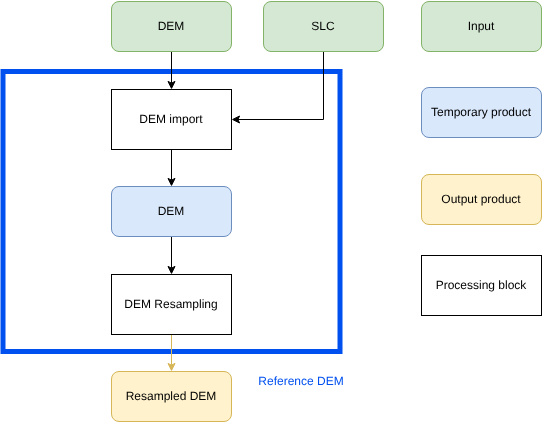

.. Copyright 2023 European Union

   Licensed under the Apache License, Version 2.0 (the "License");  
   you may not use this file except in compliance with the License.  
   You may obtain a copy of the License at  

     http://www.apache.org/licenses/LICENSE-2.0  

   Unless required by applicable law or agreed to in writing, software  
   distributed under the License is distributed on an "AS IS" BASIS,  
   WITHOUT WARRANTIES OR CONDITIONS OF ANY KIND, either express or implied.  
   See the License for the specific language governing permissions and  
   limitations under the License.  

.. _reference_DEM:  

Reference DEM
~~~~~~~~~~~~~~~~~~  

The objective of the *ReferenceDEM* unit is to retrieve the Digital Elevation Model (DEM) over the area covered by the input SLC data and resample it within the grid defined for :term:`NRB` or :term:`GSLC` products.  
The :term:`DEM` can be obtained as an external file or directly from the `Copernicus DEM portal <https://data.earthdatahub.destine.eu/copernicus-dem/GLO-30-v0.zarr>`_.  

The *ReferenceDEM* unit includes the following functionalities:  

- :ref:`DEM import <reference_DEM_import>`: Imports the DEM from the external file or the Copernicus DEM portal.  
- :ref:`DEM resampling <reference_DEM_resampling>`: Resamples the DEM onto the output grid defined for the :term:`NRB` or :term:`GSLC` products.  

The :numref:`reference_dem_unit_schema` presents a simplified schema of this functionality, including the necessary inputs and the generated outputs.  

.. _reference_dem_unit_schema_figure:  

   Diagram of *Reference DEM unit*.  

The *ReferenceDEM* unit is executed once for all bursts. The resampled DEM is then used by the *Reference Geometry Unit* to evaluate correspondences between ground and radar geometry.  
This information will subsequently be used by the *Co-registration Unit* to generate the :term:`CSLC` products and by the *Geocoding Unit* to generate the :term:`GSLC` and :term:`NRB` products.  

