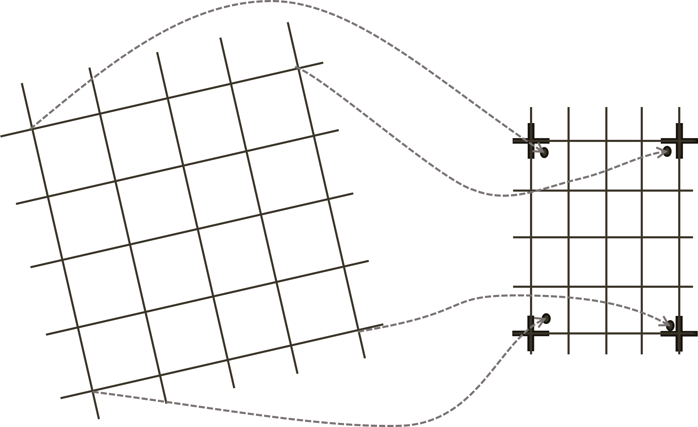
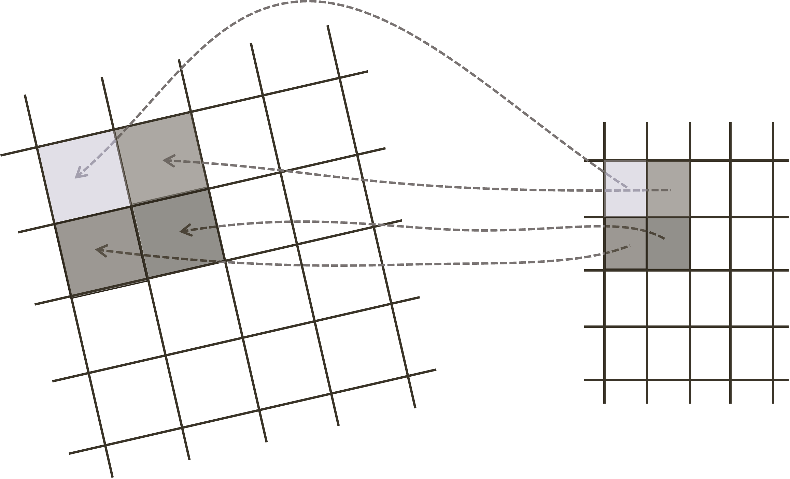
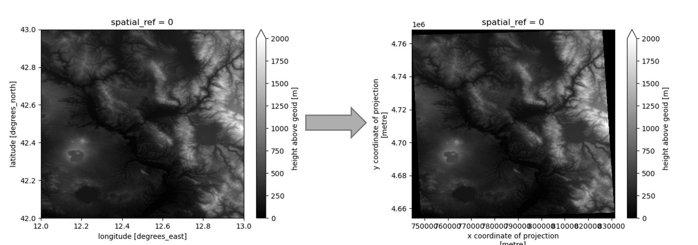

.. _reference_DEM_resampling:

DEM Resampling
~~~~~~~~~~~~~~~

Description
''''''''''''

The objective of DEM resampling is to convert the imported DEM into an output grid defined for the geocoded products (e.g. :term:`NRB`, :term:`GSLC`).  
Both the input and output grids are regularly sampled, allowing the use of standard image interpolation libraries.  
In order to avoid artifacts in the resampled DEM, it is recommended to use cubic interpolation.  

It is crucial to also account for the 3D datum transformation when performing coordinate conversion.  
In fact, the difference between geoid and ellipsoid models can be significant, potentially causing large errors in ground-to-radar coordinate conversion.  
The misalignment between the :term:`ANF`, or the topographic phase model, leads to co-registration errors in the :term:`CSLC` product, incorrect terrain slope compensation in the :term:`NRB` product, and residual fringes in the :term:`GSLC` products.

Inputs
''''''
:math:`dem_{in}`: Digital Elevation Model (DEM) in the original reference system, sampled at the original spacing.

Outputs
'''''''
:math:`dem_{out}`: Reference DEM product. The DEM is resampled over the output grid defined for the :term:`NRB` or :term:`GSLC` products.  
The offset and the spacing of the output DEM are defined according to the area covered by the input DEM.

Processing Parameters
'''''''''''''''''''''
CRS_EPSG:  
   EPSG code for the output coordinate reference system.

spacing:  
   Spacing of the output DEM in degrees.

Algorithms
''''''''''
In general, the algorithm involves four steps:

- Define the output grid based on the spacing and the area covered by the input DEM.  
  To ensure the output DEM aligns with the same grid regardless of the input DEM, the coordinates must be integer multiples of the spacing.

.. _dem_resampling_grid_figure:

   Output grid definition: the corners of the input grid (on the left) are transformed into the output coordinate reference system (represented by small circles on the right).  
   The corners of the output grid (crux) must be integer multiples of the spacing, including all points of the input grid.

- Transform the output grid into the input DEM reference system, considering the vertical datum transformation.  
  Open-source libraries exist to perform this transformation, such as `pyproj <https://pyproj4.github.io/pyproj/stable/>`_.

.. _dem_resampling_coords_figure:

   3D Coordinate transformation: each point in the output grid is transformed into the input reference system, considering the datum transformation.

- Apply interpolation to resample data on a regular grid.  
  *Cubic* interpolation is recommended to avoid artifacts in the resampled DEM.  
  Libraries such as `scipy <https://docs.scipy.org/doc/scipy/reference/generated/scipy.ndimage.map_coordinates.html>`_  
  or `rasterio <https://rasterio.readthedocs.io/en/latest/topics/resampling.html>`_ can be used for this purpose.

- Apply a transformation to the interpolated heights according to the input and output vertical datum.

An example of DEM resampling is shown in the figure below.  
The input DEM is in geographic coordinates with a spacing of 1 arcsecond and elevation information referred to the geoid EGM2008,  
while the output DEM is in UTM Zone 32 with elevation in meters with respect to the WGS84 ellipsoid.  
The output DEM is sampled at the defined spacing, and the heights are transformed according to the vertical datum transformation.

.. _dem_resampling_out_figure:

   DEM resampling: the input DEM (on the left) in geographic coordinates is transformed into the output grid (on the right) UTM Zone 32.