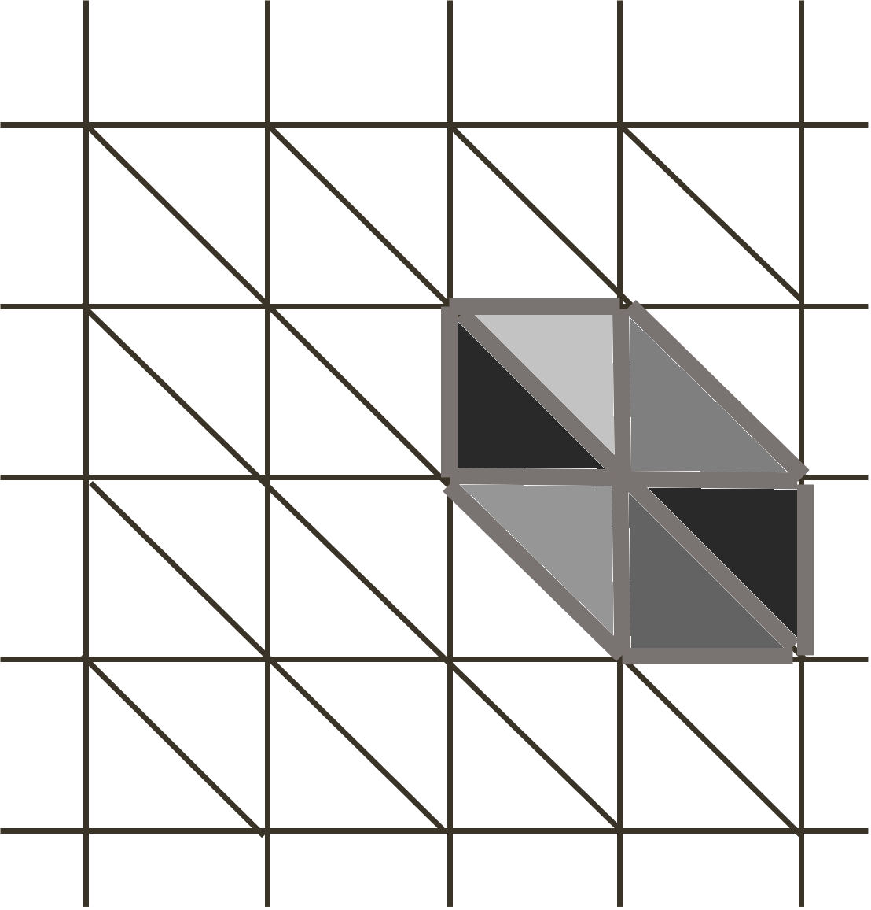
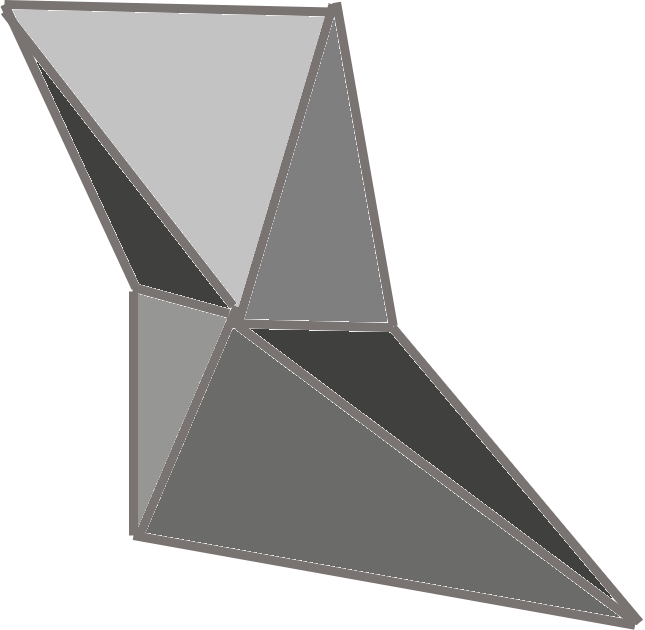
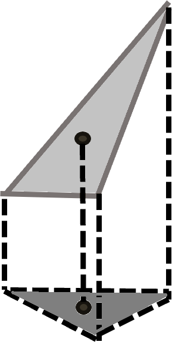

.. _sparse_grid_to_regular_grid_image_interpolation_linear:

Sparse grid to regular grid image interpolation - *griddata*
~~~~~~~~~~~~~~~~~~~~~~~~~~~~~~~~~~~~~~~~~~~~~~~~~~~~~~~~~~~~~~~~~~~~~~~~

Overview
--------

This function allows interpolation of a scattered set of values onto a regular grid using the linear interpolation method (interpolation of triangle facets). This is useful when resampling real data from ground to radar coordinates.  
The variables to be projected are:

- Offset in slant range with respect to reference geometry: :math:`\Delta t_{r_s}`
- Offset in azimuth with respect to reference geometry: :math:`\Delta t_{a_s}`
- Line of sight (LOS): :math:`LOS`
- Elevation angle: :math:`\psi`
- Local incidence angle: :math:`\theta_i`

No deramping is required, as the image is assumed to be in real format.

Conversion of offsets :math:`(\Delta t_{r_s},\Delta t_{a_s})` into radar coordinates is necessary for SLC image resampling and flattening.  
Conversion of the elevation angle :math:`\psi` into radar coordinates is necessary for evaluating shadow regions.  
Local incidence angle :math:`\theta_i` and :math:`LOS` are per-pixel metadata of the CSLC product.

Inputs
------

The tool requires the following inputs:

- Data to be interpolated
- Output coordinates

Outputs
-------

The tool provides the following outputs:

- Interpolated data

Processing parameters
---------------------
None  

Algorithm
---------

Interpolating data from a sparse grid to a regular grid requires using interpolators capable of handling irregularly sampled data.  
The adopted solution is based on triangulation followed by linear interpolation.  
It is important to note that the input data have two sets of coordinates: **geographic** and **radar coordinates**.  

- Geographic coordinates are **regularly sampled**.
- Radar coordinates are **irregularly sampled**.

The algorithm follows these steps:

1. Extract a **regular planar triangulation** using geographic coordinates, as shown in :numref:`regular_grid_triangulation`:

   Triangulation of a regular grid.

2. Substitute geographic coordinates with radar coordinates in the triangulation, obtaining a **deformed triangulation**, as shown in :numref:`irregular_grid_triangulation`:

   Deformed triangulation of radar coordinates.

3. For each triangle facet:
   - Define the **linear interpolation function**, substituting geographic coordinates with radar coordinates.
   - Apply the **linear interpolation function** to the output points belonging to the triangle, as shown in :numref:`interpolation_on_triang`:

   Interpolation of triangle facets.