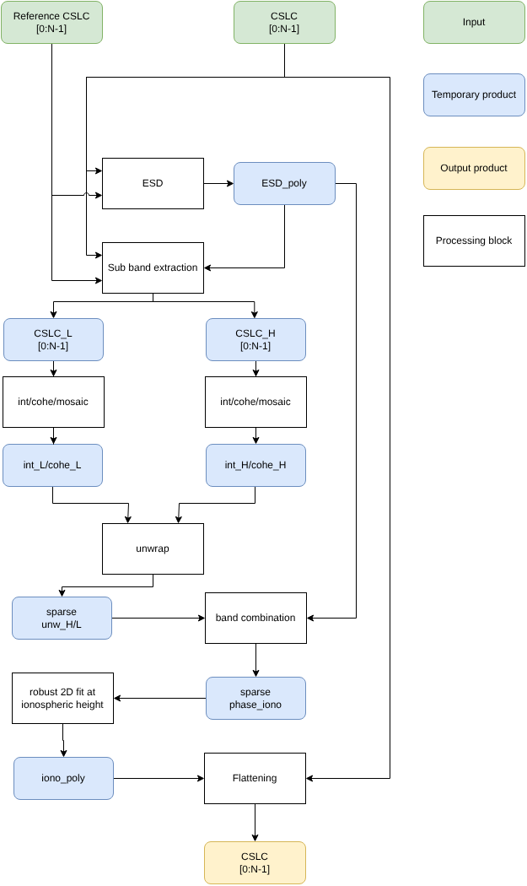

.. _split_spectrum:

Split Spectrum
'''''''''''''''''''''''''''''''''''''

Overview
--------

The Split-Spectrum technique is used to estimate and remove the ionospheric phase contribution from the interferometric phase. The method relies on the assumption that the ionospheric phase contribution is frequency-dependent, whereas the topographic phase contribution is not.

In L-band systems, **one TEC Unit (TECU)**—equivalent to :math:`10^{16}` electrons per :math:`\text{m}^2`—induces approximately **13.6 radians of phase advance**. As a result, any **spatial or temporal variations in TEC** between two SAR acquisitions introduce significant errors in the interferometric phase.

To mitigate this limitation, the **Split-Spectrum technique** has emerged as a reliable and robust method for **isolating and estimating the ionospheric phase contribution**, also known as the **ionospheric phase screen**. This technique effectively separates dispersive (ionospheric) and non-dispersive (topographic and tropospheric) components in SAR interferograms.

Inputs
------

- :math:`S`: stack of co-registered images
- :math:`R`: reference image
- :math:`f_L`: central frequency of the first sub-band
- :math:`f_H`: central frequency of the second sub-band
- :math:`f_0`: central frequency of the full band

Outputs
-------

- :math:`S'`: stack of co-registered images with phase filtered for ionospheric effects

Algorithm
---------

The interferometric phase for a sub-band centered at frequency :math:`f` is given by:

.. math::
   :label: split_spectrum_phase

   \Delta \phi = \angle {S R^*} = \frac{4 \pi f}{c} \Delta r_{nd} - \frac{4 \pi K}{c f} \Delta \text{TEC}

where:

- :math:`\Delta \phi` is the interferometric phase at frequency :math:`f`,
- :math:`c` is the speed of light,
- :math:`\Delta r_{nd}` is the non-dispersive change in range between the two acquisitions (residual topography, motion, troposphere),
- :math:`\Delta \text{TEC}` is the differential TEC between the two acquisitions.

The algorithm is based on the comparison of the interferometric phase at different frequencies (sub-bands) in order to separate the ionospheric (dispersive) and non-dispersive components. In case of burst-mode acquisition, some particular challenges arise due to phase discontinuities, that have to be addressed. 

This phase corresponds to the sum of the non-dispersive phase :math:`\phi_{nd}` and the dispersive phase :math:`\phi_{iono}`. A linear system of equations can be written for two sub-bands at frequencies :math:`f_L` and :math:`f_H`:

.. math::
   :label: split_spectrum_linear_system

   \begin{bmatrix}
   f_L / f_0 & f_0 / f_L\\
   f_H / f_0 & f_0 / f_H
   \end{bmatrix}
   \begin{bmatrix}
   \Delta \phi_{nd} \\
   \Delta \phi_{iono}
   \end{bmatrix}
   =
   \begin{bmatrix}
   \Delta \phi_L \\
   \Delta \phi_H
   \end{bmatrix}

Solving this system provides estimates of the dispersive (ionospheric) and non-dispersive components of the phase.

Using this simplified notation, the solution for the ionospheric component is:

.. math::
   :label: split_spectrum_solution

   \Delta \phi_{iono} = \frac{f_L f_H}{f_H^2 - f_L^2} \left( \Delta \phi_L \frac{f_H}{f_0} - \Delta \phi_H \frac{f_L}{f_0} \right)

The phases :math:`\Delta \phi_L` and :math:`\Delta \phi_H` must be unwrapped when applying the Split-Spectrum technique.

Due to burst acquisition mode (TOPSAR and ScanSAR), the interferometric phase may be affected by discontinuities between adjacent bursts. To make phase unwrapping feasible, it is useful to rearrange equation :eq:`split_spectrum_solution` into two components: a continuous term :math:`\Delta \hat{\phi}_{L/H}` and a discontinuous term :math:`\Delta \phi^S_{L/H}`.

.. math::
   :label: split_spectrum_solution_2

   \Delta \phi_{iono} = \frac{f_L f_H}{f_H^2 - f_L^2} \left[ \left( \Delta \hat{\phi}_L \frac{f_H}{f_0} - \Delta \hat{\phi}_H \frac{f_L}{f_0} \right) + \left( \Delta \phi^S_L \frac{f_H}{f_0} - \Delta \phi^S_H \frac{f_L}{f_0} \right) \right]

The discontinuous component is directly linked to azimuth offsets and can be estimated using models derived from data-driven approaches (e.g., ESD). Note that this estimation is only an initial guess to make phase unwrapping feasible and does not affect the estimation of the overall ionospheric phase screen.

The ionospheric phase screen, estimated over a sparse low-resolution grid, is then reconstructed across the entire image using robust interpolation or fitting techniques and applied to the original SLC image :math:`S` to obtain ionospheric phase–corrected SLC images :math:`S'`.

.. math::
   :label: split_spectrum_corrected_image

   S' = S \cdot e^{-j \Delta \phi_{iono}}

A sketch of the Split-Spectrum technique is shown in :numref:`split_spectrum_diagram`.

.. _split_spectrum_diagram_figure:

   Sketch of the Split-Spectrum technique.

The first step consists in computing, by applying the ESD technique to the full‑band signal, the azimuth corrections to be applied to the secondary image in order to ensure continuity of the interferometric phase across different bursts.  
The algorithm used to compute the ESD corrections is described in the :ref:`esd_matching` section.

Two sub‑bands are then extracted by band‑pass filtering the co‑registered SLC images. The interferometric phase and coherence are computed and mosaicked for each sub‑band, taking into account the ESD phase correction.  
The algorithm to compute the interferometric phase and coherence for each sub‑band, and to mosaic the interferograms, is described in the :ref:`interf_cohe` section.

The interferometric phases are *jointly* unwrapped, the total phase is obtained by adding back the ESD correction, and the ionospheric phase screen is estimated at sparse locations where the interferometric phase is coherent and the unwrapping is reliable.  
The joint phase unwrapping consists in computing the average phase between the two sub‑bands to reduce phase noise, and unwrapping this average phase. Then, the residual phase with respect to the average is computed for each sub‑band, unwrapped, and added to the average unwrapped phase. This approach minimizes the corrections to be applied to each sub‑band, making the phase‑unwrapping process more robust. The algorithm used to perform phase unwrapping of each layer is provided in the :ref:`unwrap` section.

The ionospheric phase screen is then reconstructed over the entire image using robust interpolation or fitting techniques, and applied to the original co‑registered CSLC to obtain the ionospheric‑phase‑corrected CSLC.

.. note::

   - Note that ESD estimation is only an initial guess to make phase unwrapping feasible and does not affect the estimation of the overall ionospheric phase screen.

   - The weighted phase combination of :math:`\Delta \phi_L` and :math:`\Delta \phi_H` requires the interferometric phase to be unwrapped when applying the Split-Spectrum technique.

   - Split-spectrum measurements are available only on a set of sparse points or areas where interferometric phase unwrapping is feasible and reliable. The ionospheric phase screen is then reconstructed over the full image using interpolation or fitting approaches.

   - Robust interpolation or fitting must be performed at ionospheric height, where the measurements are continuous and smooth. This is particularly important in the presence of variable ionospheric gradients, which may cause discontinuities between adjacent bursts.

   - Due to the potentially high rescaling factor, it is important to filter the differential measurements between the two sub-bands to avoid noise amplification. This requires strong spatial averaging for robust application of the Split-Spectrum technique, and high-frequency ionospheric features may remain uncorrected.

Code
-----

Pseudo-code to compute the ionospheric phase screen.

.. code-block:: python

    def mosaic_interf(results: tuple) -> xr.Dataset:

        interf = xr.DataTree()
        for id, (burst_id,ds) in enumerate(results):
            ds = ds.assign({'id': xr.full_like(ds.phase.isel(polarization=0, acquisition_date=0), fill_value=id, dtype='int8')})
            interf[f"bursts/{burst_id}"] = ds

        mosaic = interf.bursts[list(interf.bursts.children)[0]].to_dataset().isel(azimuth_time=slice(2, -2), slant_range_time=slice(5, -5))
        mosaic = mosaic.swap_dims({'azimuth_time': 'azimuth_time_px', 'slant_range_time': 'slant_range_time_px'})
        mosaic = mosaic.reset_coords([e for e in mosaic.coords if e not in mosaic.dims])

        for k, layer in interf.bursts.items():
            layer_sel = layer.isel(azimuth_time=slice(2, -2), slant_range_time=slice(5, -5)).to_dataset()
            layer_sel = layer_sel.swap_dims({'azimuth_time': 'azimuth_time_px', 'slant_range_time': 'slant_range_time_px'})
            layer_sel = layer_sel.reset_coords([e for e in layer_sel.coords if e not in layer_sel.dims]).compute()

            mosaic = mosaic.combine_first(layer_sel).compute()

        mosaic = mosaic.swap_dims({'azimuth_time_px': 'azimuth_time', 'slant_range_time_px': 'slant_range_time'})
        mosaic = mosaic.reset_coords([e for e in mosaic.coords if e not in mosaic.dims])

        return mosaic

    def get_mosaic_interf(slcs: xr.DataTree, reference_date: str, **kwargs) -> xr.Dataset:
        
        # compute interferograms in correspondence of each burst
        results = extract_interf_multi(slcs, reference_date, **kwargs) 

        # mosaic all interferograms
        mosaic = mosaic_interf(results)

        return mosaic

    # joint phase unwrapping of the interferograms corresponding to the two sub-bands
    def joint_unwrap(mosaic_l: xr.Dataset, mosaic_h: xr.Dataset, cohe_th: float=0.3):

        # select one polarization and the secondary acqistion date
        mosaic_h_sel = mosaic_h.isel(polarization=1, acquisition_date=1)
        mosaic_l_sel = mosaic_l.isel(polarization=1, acquisition_date=1)

        # extract the average coherence between the two sub-bands
        cohe_mask = xr.apply_ufunc(np.sqrt, (mosaic_h_sel.cohe) * (mosaic_l_sel.cohe), dask='parallelized')

        # compute the average phase between the two sub-bands
        ph_mean = xr.apply_ufunc(np.angle, np.exp(1j*(mosaic_h_sel.phase)+np.exp(1j*mosaic_l_sel.phase)), dask='parallelized')
        ph_mean_unw = cop_ard_core.unwrap.unwrap_phase(ph_mean, cohe_mask, threshold=cohe_th)

        # unwrap sub-band residues and add back the average phase
        ph_h_unw = cop_ard_core.unwrap.unwrap_phase(cop_ard_core.utils.wrap(mosaic_h_sel.phase-ph_mean_unw), cohe_mask, threshold=cohe_th)+ph_mean_unw
        ph_l_unw = cop_ard_core.unwrap.unwrap_phase(cop_ard_core.utils.wrap(mosaic_l_sel.phase-ph_mean_unw), cohe_mask, threshold=cohe_th)+ph_mean_unw

        return ph_l_unw, ph_h_unw

    # core function to separate dispersive and non-dispersive components
    def split_spectrum_core(phase_unw_l: xr.DataArray, phase_unw_h: xr.DataArray, f0: float, f_l_tot: float, f_h_tot: float) -> [xr.DataArray, xr.DataArray]:

        # dispersive component
        phase_iono = (phase_unw_l * (f_h_tot/f0) - phase_unw_h * (f_l_tot/f0)) * (f_l_tot * f_h_tot) / (f_h_tot**2 - f_l_tot**2)

        # non-dispersive component
        phase_nd = (phase_unw_h * (f_h_tot/f0) - phase_unw_l * (f_l_tot/f0)) * f0 / (2*(f_h_tot - f_l_tot))

        return phase_iono, phase_nd

    # robuts polynomial fitting
    def fit_ionosphere(phase_iono: xr.Dataset, H_iono: float, H_orb: float, degree: int=1, norm: int=1):

        y_ = scale_azimuth_time(phase_iono.azimuth_time_raw, 
                                phase_iono.azimuth_time,
                                H_orb,
                                H_iono)

        # compute minimization axis
        x_ = np.tile(phase_iono.slant_range_time.values, phase_iono.azimuth_time.size).reshape(phase_iono.azimuth_time_raw.shape)
        y_ = (y_ - y_[0,0]).astype(float).values
        data = phase_iono.squeeze().stack(point=['azimuth_time', 'slant_range_time']).values

        # compute polynomial fit coefficients
        coeffs, x_sc, x_0 = fit_2d_poly(x_, y_, data, degree=degree, norm=norm)

        # costruct dataarray with fit coefficients and attributes for rescaling and centering the coordinates
        coeffs = xr.DataArray(coeffs.x, dims=['degree'], coords={'degree': np.arange(coeffs.size)})
        coeffs.attrs['offset'] = x_0
        coeffs.attrs['scale_fact'] = x_sc
       
    # remove ionospheric component from the original SLC images for a single burst
    def remove_iono_surface_single_burst(burst: xr.Dataset, coeffs: xr.DataArray, 
                                         H_iono: float, H_orb: float, 
                                         degree: int=1, 
                                         ):

        # recontruct the surface over all points
        cstack = burst['coreg/measurements/cstack']

        # compute raw  azimuth time 
        azimuth_time_raw = cop_ard_core.utils.get_azimuth_time_raw(cstack)

        # rescale the time to the ionospheric height
        azimuth_time_iono = scale_azimuth_time(azimuth_time_raw, 
                                cstack.azimuth_time,
                                H_orb,
                                H_iono)

        # compute minimization axis
        x_ = np.tile(cstack.slant_range_time.values, cstack.azimuth_time.size).reshape(azimuth_time_raw.shape)
        y_ = (azimuth_time_iono - azimuth_time_iono[0,0]).astype(float).values
        x_full = np.vstack([x_.ravel(), y_.ravel()]).T 
        x_full = (x_full - coeffs.attrs['offset']) / coeffs.attrs['scale_fact']

        # reconstruct the surface in correspondence of the coordinates x_full
        surf = fit(get_model_matrix(x_full, regions=None, degree=degree), coeffs.values)
        surf = surf.reshape(azimuth_time_raw.shape)
        surf = xr.DataArray(surf, dims=['azimuth_time', 'slant_range_time'])
        
        # return the ionospheric layer
        burst['coreg/measurements/phase_iono'] = surf
        
        # remove ionosphere from slc
        burst['coreg/measurements/cstack'].loc[{'acquisition_date':date}]  *= np.exp(-1j*burst.coreg.measurements.phase_iono)

        return burst

    # remove ionospheric component from the original SLC images for all single burst
    def remove_iono_surface(slcs: xr.DataTree, coeffs: xr.DataArray,
                            H_iono: float, H_orb: float,
                            degree: int=1):

        # init out datatree
        slcs_filt = xr.DataTree()
        for burst_id, burst in slcs.bursts.items():
            slcs_filt[f'bursts/{burst_id}'] = remove_iono_surface_single_burst(burst, coeffs, H_iono, H_orb, degree=degree)

        return slcs_filt

    ########################################################
    # main function to apply split spectrum technique
    ########################################################

    # lower band interferogram centered at frequency f_L, with bandwidth bw, coinsidering an azimuth polynomial offset descriptor y_poly, 
    # a coherence threshold cohe_th to select the points where the split spectrum technique is applied
    mosaic_l = get_mosaic_interf(slcs, reference_date, f0=f_L, bw=bw, bbox=bbox, multilook=multilook, y_poly=y_poly)

    # upper band interferogram centered at frequency f_H, with bandwidth bw, coinsidering an azimuth polynomial offset descriptor y_poly, 
    # a coherence threshold cohe_th to select the points where the split spectrum technique is applied
    mosaic_h = get_mosaic_interf(slcs, reference_date, f0=f_H, bw=bw, bbox=bbox, multilook=multilook, y_poly=y_poly)

    # joint interferogram phase unwrapping
    phase_unw_l, phase_unw_h = joint_unwrap(mosaic_l, mosaic_h, cohe_th = cohe_th)

    # add back the phase ramp to the unwrapped phase
    phase_tot_l = phase_unw_l + mosaic_l.phase_ramp
    phase_tot_h = phase_unw_h + mosaic_h.phase_ramp

    # separate dispersive and non-dispersive components
    phase_iono, phase_nd = split_spectrum_core(phase_tot_l, phase_tot_h, f0, f_l_tot, f_h_tot)

    # assign azimuth time of raw image in order to enable interpolation
    phase_iono['azimuth_time_raw'] = mosaic_l['azimuth_time_raw']

    # fit surface at ionospheric height
    coeffs = fit_ionosphere(phase_iono.isel(acquisition_date=1), H_iono, H_orb, degree=degree, norm=norm)

    # remove the ionosphere from the original SLC images for each single burst
    slcs_filt = remove_iono_surface(slcs, coeffs, H_iono, H_orb, degree=degree)

Detailed variables description
------------------------------

.. list-table:: Variable Description Table
   :widths: 25 50
   :header-rows: 1

   * - Property
     - Value
   * - Symbol
     - :math:`S`
   * - Description
     - Interferometric stack of co-registered images
   * - Purpose
     - Input
   * - Units
     - N/A
   * - Type
     - complex float array
   * - Dimensionality
     - (slant range, azimuth)
   * - Range of values
     - N/A
   * - Initial/default values
     - N/A
   * - Name in pseudo-code
     - N/A
   * - 
     -
   * - Symbol
     - :math:`S'`
   * - Description
     - Interferometric stack of co-registered images filtered for ionospheric effects
   * - Purpose
     - Output
   * - Units
     - N/A
   * - Type
     - complex float array
   * - Dimensionality
     - (slant range, azimuth)
   * - Range of values
     - N/A
   * - Initial/default values
     - N/A
   * - Name in pseudo-code
     - N/A
   * - 
     -
   * - Symbol
     - :math:`\Delta \phi_{iono}`
   * - Description
     - Interferormetic phase component due to ionospheric effects
   * - Internal
     - Output
   * - Units
     - radians
   * - Type
     - float array
   * - Dimensionality
     - (slant range, azimuth)
   * - Range of values
     - N/A
   * - Initial/default values
     - N/A
   * - Name in pseudo-code
     - N/A
   * - 
     -
   * - Symbol
     - :math:`\Delta \phi_{nd}`
   * - Description
     - Interferormetic phase non dispersive component
   * - Purpose
     - Internal
   * - Units
     - radians
   * - Type
     - float array
   * - Dimensionality
     - (slant range, azimuth)
   * - Range of values
     - N/A
   * - Initial/default values
     - N/A
   * - Name in pseudo-code
     - N/A
   * - 
     -
   * - Symbol
     - :math:`\Delta \phi_L`
   * - Description
     - Interferormetic phase of the first sub-band
   * - Purpose
     - Internal
   * - Units
     - radians
   * - Type
     - float array
   * - Dimensionality
     - (slant range, azimuth)
   * - Range of values
     - N/A
   * - Initial/default values
     - N/A
   * - Name in pseudo-code
     - N/A
   * - 
     -
   * - Symbol
     - :math:`\Delta \phi_H`
   * - Description
     - Interferormetic phase of the second sub-band
   * - Purpose
     - Internal
   * - Units
     - radians
   * - Type
     - float array
   * - Dimensionality
     - (slant range, azimuth)
   * - Range of values
     - N/A
   * - Initial/default values
     - N/A
   * - Name in pseudo-code
     - N/A
   * - 
     -
   * - Symbol
     - :math:`\Delta \phi^S_L`
   * - Description
     - Discontinuous interferometric phase of the first sub-band
   * - Purpose
     - Internal
   * - Units
     - radians
   * - Type
     - float array
   * - Dimensionality
     - (slant range, azimuth)
   * - Range of values
     - N/A
   * - Initial/default values
     - N/A
   * - Name in pseudo-code
     - N/A
   * - 
     -
   * - Symbol
     - :math:`\Delta \phi^S_H`
   * - Description
     - Discontinuous interferometric phase of the second sub-band
   * - Purpose
     - Internal
   * - Units
     - radians
   * - Type
     - float array
   * - Dimensionality
     - (slant range, azimuth)
   * - Range of values
     - N/A
   * - Initial/default values
     - N/A
   * - Name in pseudo-code
     - N/A
   * - 
     -
   * - Symbol
     - :math:`\Delta \hat{\phi}_L`
   * - Description
     - Discontinuous interferometric phase of the first sub-band
   * - Purpose
     - Internal
   * - Units
     - radians
   * - Type
     - float array
   * - Dimensionality
     - (slant range, azimuth)
   * - Range of values
     - N/A
   * - Initial/default values
     - N/A
   * - Name in pseudo-code
     - N/A
   * - 
     -
   * - Symbol
     - :math:`\Delta \hat{\phi}_H`
   * - Description
     - Discontinuous interferometric phase of the second sub-band
   * - Purpose
     - Internal
   * - Units
     - radians
   * - Type
     - float array
   * - Dimensionality
     - (slant range, azimuth)
   * - Range of values
     - N/A
   * - Initial/default values
     - N/A
   * - Name in pseudo-code
     - N/A
   * - 
     -
   * - Symbol
     - :math:`f_L`
   * - Description
     - Central frequency of the first sub-band
   * - Purpose
     - Internal
   * - Units
     - Hz
   * - Type
     - float
   * - Dimensionality
     - scalar
   * - Range of values
     - N/A
   * - Initial/default values
     - N/A
   * - Name in pseudo-code
     - N/A
   * - 
     -
   * - Symbol
     - :math:`f_H`
   * - Description
     - Central frequency of the second sub-band
   * - Purpose
     - Internal
   * - Units
     - Hz
   * - Type
     - float
   * - Dimensionality
     - scalar
   * - Range of values
     - N/A
   * - Initial/default values
     - N/A
   * - Name in pseudo-code
     - N/A
   * - 
     -
   * - Symbol
     - :math:`f_0`
   * - Description
     - Central frequency of the full band
   * - Purpose
     - Internal
   * - Units
     - Hz
   * - Type
     - float
   * - Dimensionality
     - scalar
   * - Range of values
     - N/A
   * - Initial/default values
     - N/A
   * - Name in pseudo-code
     - N/A