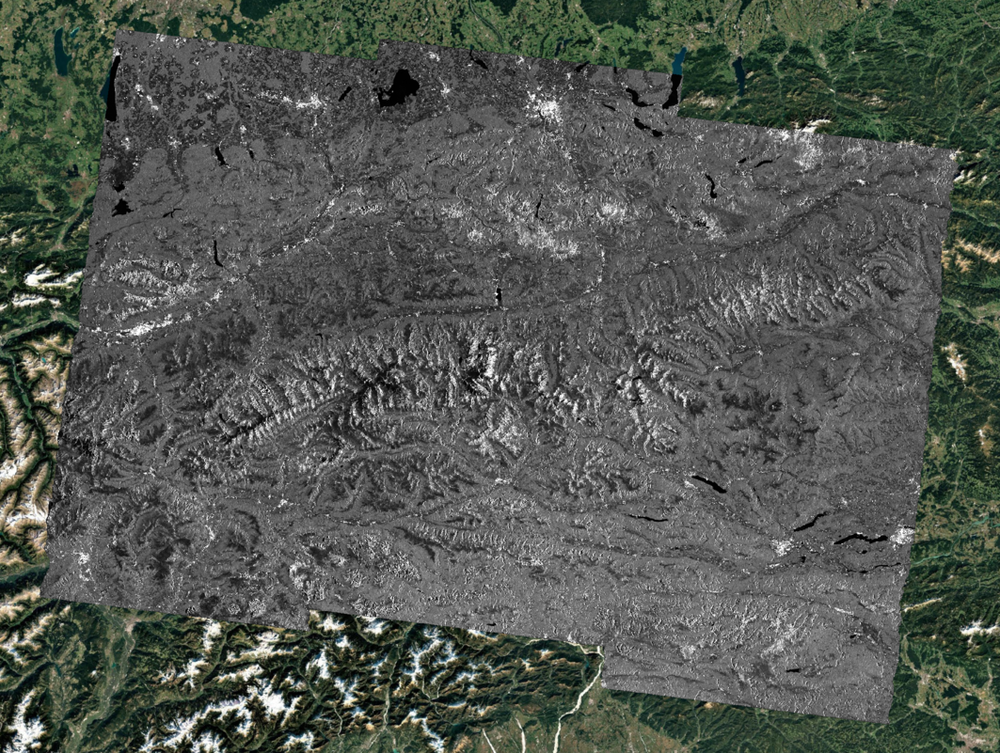
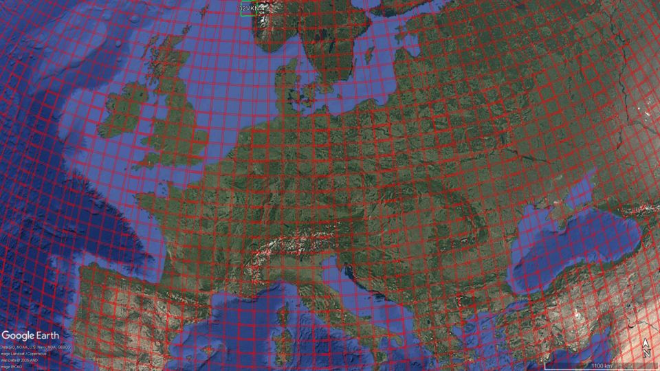
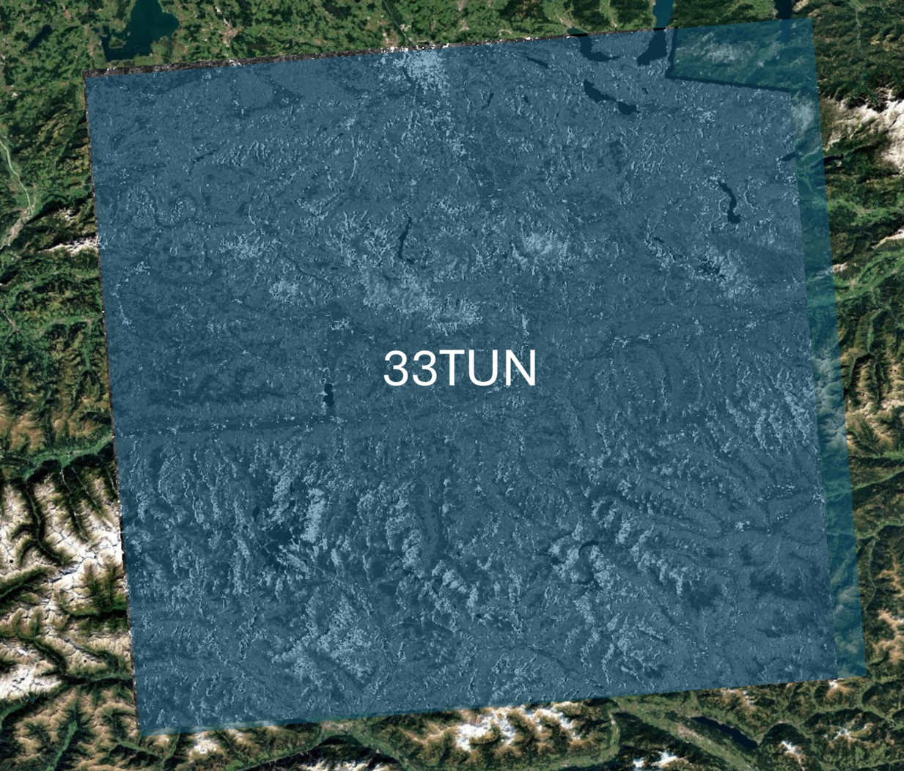

.. _tiling:

Tiling
'''''''

Overview
--------

This document provides guidelines for dividing Normalized Reflectance (NRB) products into tiles following the Sentinel-2 tiling scheme.  
The tiling structure ensures compatibility with standard Sentinel-2 processing workflows.
If the mosaic covers multiple UTM zones, the data corresponding to tiles in different UTM zones with respect to the input mosaic are first reprojected and then tiled.

Inputs
------

- NRB mosaicked products.  
- Sentinel-2 MGRS modified tile grid definition.  

Outputs
-------

- Tiled NRB products conforming to the Sentinel-2 tiling scheme.  

Processing Parameters
---------------------

None

Algorithm
---------

The tiling procedure follows these steps:

- Import the NRB dataset into a geospatial processing environment.

:numref:`nrb_095` shows the result of NRB mosaicking of all bursts corresponding to a standard Sentinel-1 L1 product over track 095.

.. _nrb_095_figure:

   NRB mosaicking of all bursts corresponding to a standard Sentinel-1 L1 product over track 095.

- Using Sentinel-2 tile definitions to determine target tile boundaries.

:numref:`s2_grid_schema` shows a detail of the Sentinel-2 modified MGRS grid over Europe.

.. _s2_grid_figure:

   Detail of Sentinel-2 modified MGRS grid over Europe.

- Extract image subsets corresponding to the Sentinel-2 tiles, and convert data into the Sentinel-2 coordinate reference system, if needed.

:numref:`nrb_tile` shows the tile 33TUN of the NRB product extracted from the mosaic above.

.. _nrb_tile_figure:

   Tile 33TUN of the NRB product extracted from the mosaic above.