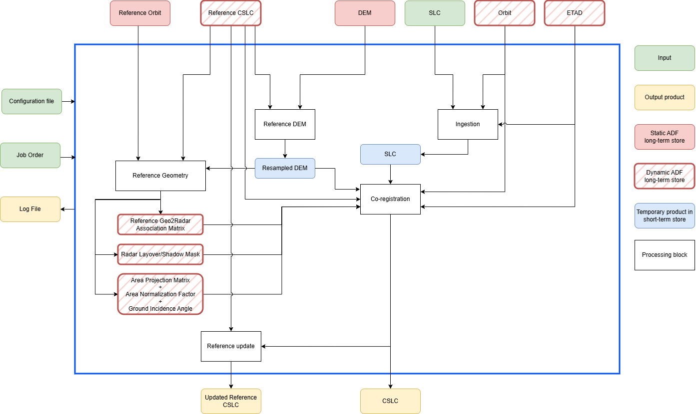
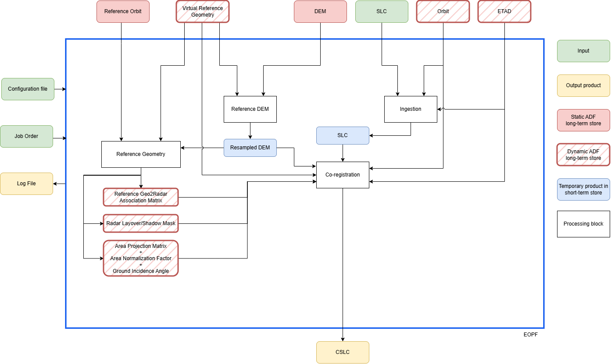

.. Copyright 2023 European Union

   Licensed under the Apache License, Version 2.0 (the "License");
   you may not use this file except in compliance with the License.
   You may obtain a copy of the License at

     http://www.apache.org/licenses/LICENSE-2.0

   Unless required by applicable law or agreed to in writing, software
   distributed under the License is distributed on an "AS IS" BASIS,
   WITHOUT WARRANTIES OR CONDITIONS OF ANY KIND, either express or implied.
   See the License for the specific language governing permissions and
   limitations under the License.

.. _cslc_label:

========================================================
Algorithm Theoretical Basis Document (ATBD) 
========================================================

The generation of CSLC products involves several complex processing units and an overview of the most general processing workflow is reported in :numref:`CSLC_diagram_rosel`.

.. _CSLC_diagram_rosel_figure:

   High-level workflow for *CSLC* generation for ROSE-L data.

In case of Sentinel-1 data where the model-based co-registration is sufficient, the schema simplifies as shown in :numref:`CSLC_diagram_sentinel1`.

.. _CSLC_diagram_sentinel1_figure:

   High-level workflow for *CSLC* generation for Sentinel-1 data.

The processing units involved are:

- :ref:`Ingestion <ingestion>`: The *Ingestion Unit* includes the steps for importing input SLC data, applying amplitude calibration, and phase deramping.
- :ref:`Reference DEM <reference_DEM>`: The *Reference DEM Unit* includes the step for generating a DEM interpolated onto the output geographic grid of the geocoded ARD products.
- :ref:`Reference Geometry <reference_geometry>`: The *Reference Geometry Unit* includes all steps required to generate geometric information, stored in intermediate products, and needed by some *Co-registration* and *Geocoding* steps. The outputs of the *Reference Geometry Unit* can be stored in a static archive and reused by other processing units as needed.
- :ref:`Co-registration <coregistration>`: The *Co-registration Unit* produces CSLC products with respect to a reference radar grid ("real" or "virtual"). It is possible to apply models (e.g. ETAD corrections, including focusing approximations, ionospheric and tropospheric delay, geodetic correction, ocean tidal loading), or compute the corrections to the model based coregistration, through data-driven co-registration. In particular, the following techniques can be exploited: image cross-correlation (ICC), Enhanced spectral diversity (ESD) and split-specturm with respect to a real reference image.

.. note::

   - All the images before applying the data-driven co-registration, including the "real" reference image, are resampled in the reference radar grid.

   - The output of the *Reference Geometry Unit* is used by the *Coregistration Unit* to align all the images, including the "real" reference image, to output reference grid (eventually "virtual").

   - The *Geocoding Unit* internally optionally performs the :ref:`gamma-flattening <gamma_flattening>` step before projecting the data. This operation is perfomrmed in radar geometry on the CSLC product.
   

.. toctree::
   :maxdepth: 1
   :hidden:

   ../common/ingestion
   ../common/coregistration