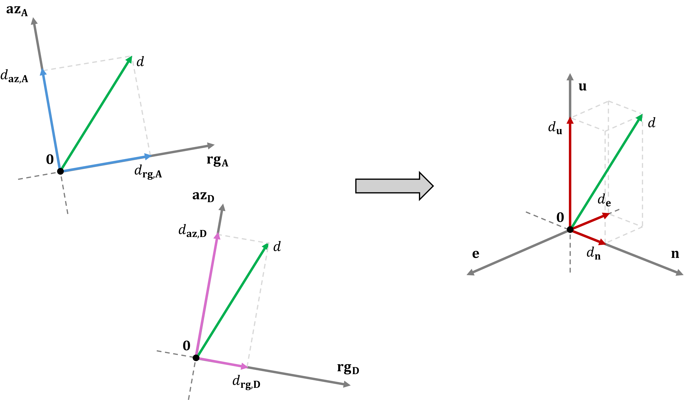

.. Copyright 2023 European Union

   Licensed under the Apache License, Version 2.0 (the "License");
   you may not use this file except in compliance with the License.
   You may obtain a copy of the License at

     http://www.apache.org/licenses/LICENSE-2.0

   Unless required by applicable law or agreed to in writing, software
   distributed under the License is distributed on an "AS IS" BASIS,
   WITHOUT WARRANTIES OR CONDITIONS OF ANY KIND, either express or implied.
   See the License for the specific language governing permissions and
   limitations under the License.

.. _ggm_label:

========================================================
Algorithm Theoretical Basis Document (ATBD)
========================================================

Input data
=============

The GGM product take in input PRO / PAO products obtained from two complementary geometries (e.g. ascending and descending):

- :math:`\Delta _{rg} ^i, \forall i \in {a,d}`: Offsets measured along slant range direction (in meters)    
- :math:`\Delta _{az} ^i, \forall i \in {a,d}`: Offsets measured along azimuth direction (in meters)

Algorithm description
========================

The relation between the 3D surface displacement :math:`\mathbf{d} = [\textbf{d}^e, \textbf{d}^n, \textbf{d}^u]^\top` (east, north, up), and the displacement measuremenst in the two radar directions can be expressed as a linear combination: 

.. math::
   :label: ggm_eq
   
   \mathbf{d} = \mathbf{A} \mathbf{u}

Where the measurement vector is:

.. math::
   :label: ggm_measurement_vector

   \mathbf{d} =
   \begin{bmatrix}
   \Delta _{rg} ^a \\
   \Delta _{rg} ^d \\
   \Delta _{az} ^a \\
   \Delta _{az} ^d 
   \end{bmatrix}

And the design matrix :math:`\mathbf{A}` is composed of unit vectors for each geometry:

.. math::
   :label: ggm_design_matrix
   
   \mathbf{A} =
   \begin{bmatrix}
   \textbf{los}^{a}_{e} & \textbf{los}^{a}_{n} & \textbf{los}^{a}_{u} \\
   \textbf{los}^{d}_{e} & \textbf{los}^{d}_{n} & \textbf{los}^{d}_{u} \\
   \textbf{lof}^{a}_{e} & \textbf{lof}^{a}_{n} & \textbf{lof}^{a}_{u} \\
   \textbf{lof}^{d}_{e} & \textbf{lof}^{d}_{n} & \textbf{lof}^{d}_{u}
   \end{bmatrix}

The overdetermined system is solved using the Least Mean Square Error (LMSE) method:

.. math::
   :label: ggm_lmse_solution

   \hat{\mathbf{u}} = (\mathbf{A}^\top \mathbf{A})^{-1} \mathbf{A}^\top \mathbf{d}

.. _ggm_scheme:

   Simple graphic scheme for the generation of the GGM products starting from the PRO/PAO products.

Being the measurement noise non-uniform, a weighted LMSE solution is applied:

.. math::
   :label: ggm_weighted_lmse_solution

   \hat{\mathbf{u}} = (\mathbf{A}^\top \mathbf{W} \mathbf{A})^{-1} \mathbf{A}^\top \mathbf{W} \mathbf{d} = \mathbf{L} \mathbf{d}

Where :math:`\mathbf{W}` is a diagonal weight matrix based on inverse variances:

.. math::
   :label: ggm_weight_matrix

   \mathbf{W} = \operatorname{diag} \left( \sigma_{\text{a}, rg}^2, \sigma_{\text{d}, rg}^2, \sigma_{\text{a}, az}^2, \sigma_{\text{d}, az}^2 \right)^{-1}

With :math:`\sigma_r` and :math:`\sigma_a` denoting standard deviations of range and azimuth offsets. Then:

.. math::
   :label: ggm_lmse_weighted_solution

   \mathbf{L} = (\mathbf{A}^\top \mathbf{W} \mathbf{A})^{-1} \mathbf{A}^\top \mathbf{W}

Azimuth offset noise in Sentinel-1 and ROSE-L data is significantly higher than range offset noise. This discrepancy must be considered when refining displacement products. Since azimuth offsets are up to two orders of magnitude noisier, it’s advisable to **coarsen the azimuth resolution** using spatial averaging (e.g. multilook) to improve reliability of azimuth-constrained products.
