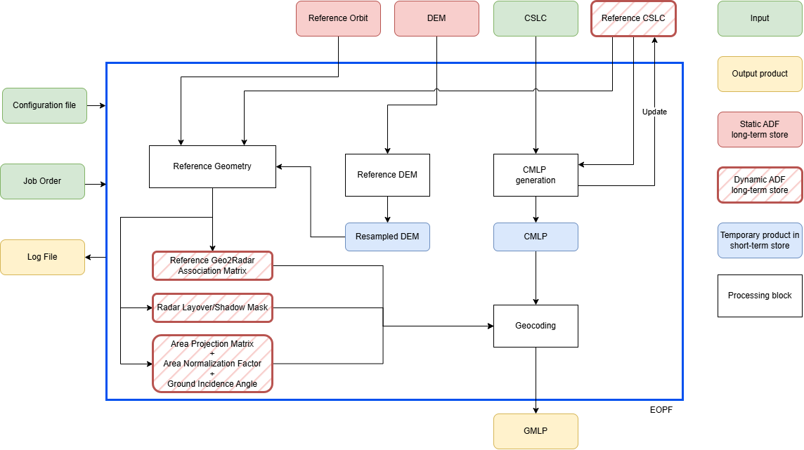

.. Copyright 2023 European Union

   Licensed under the Apache License, Version 2.0 (the "License");
   you may not use this file except in compliance with the License.
   You may obtain a copy of the License at

     http://www.apache.org/licenses/LICENSE-2.0

   Unless required by applicable law or agreed to in writing, software
   distributed under the License is distributed on an "AS IS" BASIS,
   WITHOUT WARRANTIES OR CONDITIONS OF ANY KIND, either express or implied.
   See the License for the specific language governing permissions and
   limitations under the License.

.. _mlc_label:

========================================================
Algorithm Theoretical Basis Document (ATBD) 
========================================================

The generation of GMLP products involves two main stages: the generation of the multilooked phase in radar geometry (CMLP) and the geocoding of the resulting image (Geocoding). An overview of the processing workflow is reported in :numref:`GMLP_diagram`.

.. _GMLP_diagram_figure:

   High-level workflow for *GMLP* generation.

The processing units involved are:

- :ref:`Reference DEM <reference_DEM>`: The *Reference DEM Unit* includes the step for generating a DEM interpolated onto the output geographic grid of the geocoded ARD products.
- :ref:`Reference Geometry <reference_geometry>`: The *Reference Geometry Unit* includes all steps required to generate geometric information, stored in intermediate products, and needed by some *Co-registration* and *Geocoding* steps. The outputs of the *Reference Geometry Unit* can be stored in a static archive and reused by other processing units as needed.
- :ref:`CMLP generation <cmlp_generation>`: The *CMLP generation Unit* produces multilooked interferograms in the reference radar grid. All the corrections applied in the co-registration step are inherited in the CMLP product.
- :ref:`Geocoding <geocoding>`: The *Geocoding Unit* includes the steps for geocoding the CMLP product, which can be performed with different approaches (e.g. point or area projection) depending on the expected resolution of the input and output product, and on the type of data to be projected (e.g. complex or real values, phase products, etc.).

.. toctree::
   :maxdepth: 1
   :hidden:

   cmlp_generation
   ../common/geocoding
