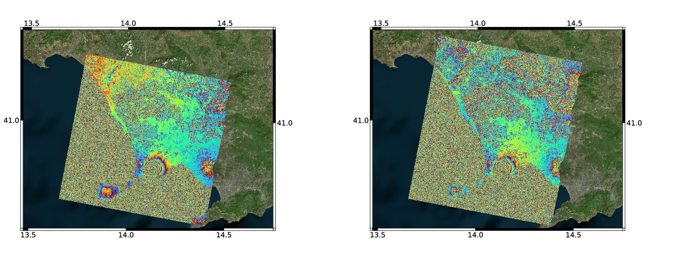
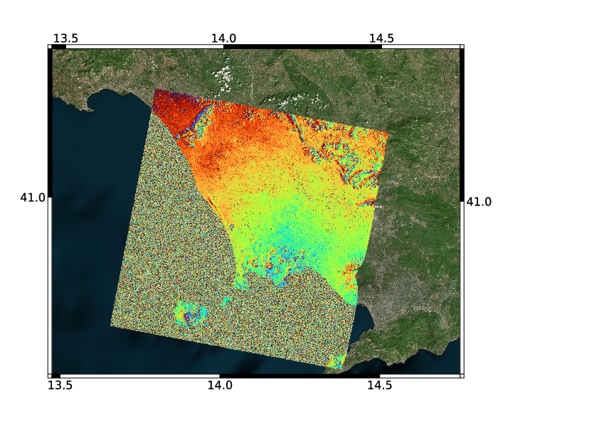

.. _gmlp_data_vis:

=====================
Data visualization
=====================

Interferogram generation in GIS software
--------------------------------------------

It is possible to generate interferograms directly in a GIS software. Once the zarr file is loaded, one needs only calling a "raster calculator" function operating on two chosen dates. 
For example in QGIS on can pick two rasters that correspond to the chose dates and take the phase difference

.. math::
    \phi = \phi_1 - \phi_2

and feed it to a function that realizes the two-argument arctangent by using only the common arctangent, sine, and cosine:

.. math::
    \varphi = \mathrm{atan2}\left(\sin(\phi), \cos(\phi)\right) = 2\:\mathrm{atan}\left(\frac{\sin(\phi)}{1+\cos(\phi)}\right)= 2\:\mathrm{atan}\left(\frac{1- \cos(\phi)}{\sin(\phi)}\right).

This is exemplified in the following figures. The fist of which shows two original phase products (GMLP), representing two (roughly) 5-year interferograms. Re-wrapping the difference with the arctangent function we obtain the second figure, representing a 16-day interferogram between the two dates (2025-01-14 and 2020-01-30).

   
   Two GMLP products which represent 5-year interferograms. The reference image is at the beginning of the stack (2020-03-13). Left: 2025-01-24. Right: 2025-01-30.

   
   A 16-day interferogram derived from the two GMLP product. The computation is a band-math operation performed directly in QGIS.
