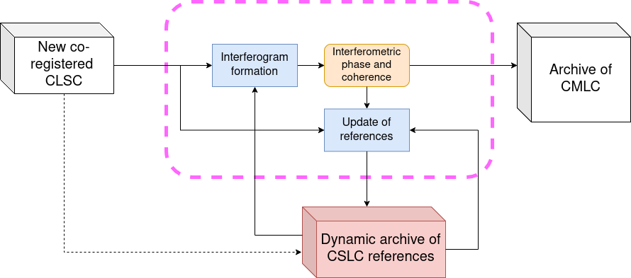
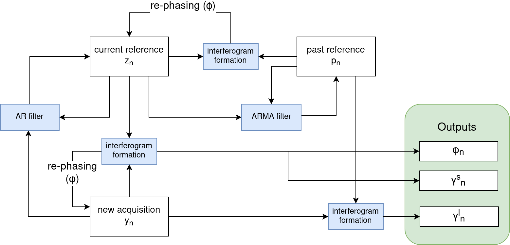

.. _mlc_label:

========================================================
Algorithm Theoretical Basis Document (ATBD) 
========================================================

   High-level workflow for CMLC generation.

Input data
=============

SAR data
------------

The input for the generation of this product is a CSLC product, i.e. a stack of co-registered slc's in radar geometry. The algorithm is designed to work with continuous updates, so that it is not necessary to have access to the entire stack at each step, for each new incoming acquisition.

Internal data
-----------------

This algorithm keeps two special images between each update step, one is called "current reference" and the other "past reference". These images are linear combinations of images that have been already processed and are introduced to avoid accessing the entire past history.

Auxiliary data
------------------

None (TBC).

Algorithm description
========================

   Detailed internal workflow for CMLC generation.

Phase and short-term coherence estimation
---------------------------------------------

The multilooked phase is going to be generated by interfering each incoming CSLC acquisition :math:`y_n` with the current reference :math:`z_n` (a “running reference”) and averaging over a small pixel neighborhood :math:`\Omega`:

.. math::
    \phi_n = \angle \sum_{(r,a) \in \Omega} z_n^*(r,a) y_n(r,a).

In our implementation the neighborhood is simply a rectangular window.
At the very beginning, the reference :math:`z_n` is going to be initialized with the first image in the CSCL stack (i.e. :math:`z_1 = y_1`). Later it is going to be updated as described below.

The short-term coherence :math:`\gamma^s_n` is simply taken as the coherence of the same interferogram between :math:`y_n` and :math:`z_n` shown above.

Current reference update
-----------------------------
After the estimation of the interferometric phase :math:`\phi_n`, we are going to use it to update the current reference :math:`z_n` by including the contribution of the current CSLC :math:`y_n.`

.. math::
    z_{n+1} = \alpha z_n + y_n e^{-j\phi_n}.

The memory parameter :math:`\alpha` controls the bandwidth of the current reference, a small parameter corresponds to a short memory, which is optimal for fast-decorrelating scenarios. A large value of the parameter is suited to stable targets.

Current reference calibration
---------------------------------

As time passes, the current reference risks drifting away from the phase of the first acquisition of the stack. For this reason we are going to calibrate its phase with a more stable reference :math:`p` by generating an interferogram and compensating the phase:

.. math::
    \varphi_n = \angle \sum_{(r,a) \in \Omega} p_n^*(r,a) z_{n+1}(r,a).

.. math::
    z_{n+1} \leftarrow z_{n+1} e^{-j\varphi_n}.

The phase compensation is performed only if the coherence between :math:`p_n` and :math:`z_{n+1}` is above a chosen threshold (e.g. 0.1) to avoid adding noise in cases of low coherence.

Stable reference generation and update
------------------------------------------

We take initially a snapshot of the current reference :math:`z` as a stable reference :math:`p` after a certain number of update steps (e.g. :math:`m=10` which would correspond to 60 days for a 6-day repeat ROSE-L time series):

.. math::
    p_n = z_n, \quad \textrm{for} \quad n=M.

After that we update the stable reference with a pace with is slower than the pace we update the current reference, so that the stable reference represents older acquisitions.

.. math::
    p_{n+1} = \beta_1 p_n + \beta_2 z_n.

With the choice :math:`\beta_1 = 1, \beta_2=1` the stable reference is simply the sum of all past "current references" from step :math:`M` onwards. It represents therefore the mid-point between the current acquisition and the :math:`M^{th}` acquisition.

With the choice :math:`\beta_2=0` the stable reference is not going to be updated with new information and remains frozen.

The long-term coherence :math:`\gamma^l_n` is taken as the coherence of the same interferogram between :math:`y_n` and :math:`p_n`.

Geocoding
-------------
* :ref:`GEOCODING <common_geocoding_label>`

Mosaicking
--------------
* :ref:`MOSAIC <common_mosaic_label>`

Algorithm complexity
====================
The algorithm is computationally very cheap once the CSLC product is available. In involves the generation of a couple of interferograms at each step (i.e. for each new incoming acquisition), re-phasing of the SLC data and linear combinations. It is designed for a continuous update: for example it does not to include any matrix inversion, differently from (:cite:author:`Teba2008,Ansari2017, Ansari2018`). The complexity grows linearly with the number of acquisitions.

In contrast, algorithms based on the coherence matrix have a complexity that grows quadratically with the number of acquisitions since the number of interferograms is the square of the number of images. If the algorithm foresees a matrix inversion the complexity is potentially even higher.

Possible algorithm improvements
===============================
- Better sampling in radar coordinates of CMLC product
- Saving and make use of several "past references", e.g. one for each year
- Adaptive parameter selection for the temporal filter, which should be coherence-dependent. This is not trivial as we need to optimize simultaneously the short and the long-term coherence.

..
    Validation and Quality Assessment
    =====================================

  * Test 1
  * Test 2

References
=============

.. bibliography::

Appendices
=============

Detailed variable description
-----------------------------

.. list-table:: Variable Description Table
   :widths: 25 50
   :header-rows: 1

   * - Property
     - Value
   * - Symbol
     - :math:`y_n`
   * - Description
     - A patch of co-registered slc data (from the n-th acquisition)
   * - Purpose
     - Input: SAR data
   * - Units
     - (see CSLC product)
   * - Type
     - complex float array
   * - Dimensionality
     - (range, azimuth) or vectorized in a single spatial dimension
   * - Range of values
     - N/A
   * - Initial/default values
     - N/A
   * - Name in pseudo-code
     - ``slc``
   * - 
     -
   * - Symbol
     - :math:`z_n`
   * - Description
     - The current reference, a linear combination of past co-registered slc data until the (n-1)-th acquisition
   * - Purpose
     - Internal: an interferometric reference to estimate the interferometric phase for the n-th acquisition 
   * - Units
     - (see CSLC product)
   * - Type
     - complex float array
   * - Dimensionality
     - (range, azimuth) or vectorized in a single spatial dimension
   * - Range of values
     - N/A
   * - Initial/default values
     - :math:`y_1`, i.e. the first acquisition
   * - Name in pseudo-code
     - ``current_reference``
   * - 
     -
   * - Symbol
     - :math:`p_n`
   * - Description
     - The past reference, a linear combination of current references
   * - Purpose
     - Internal: an interferometric reference to calibrate the phase of the current reference 
   * - Units
     - (see CSLC product)
   * - Type
     - complex float array
   * - Dimensionality
     - (range, azimuth) or vectorized in a single spatial dimension
   * - Range of values
     - N/A
   * - Initial/default values
     - :math:`p_n = z_n`, for a fixed :math:`M` (minimum stack size)
   * - Name in pseudo-code
     - ``past_reference``
   * - 
     -
   * - Symbol
     - :math:`\phi_n`
   * - Description
     - The interferometric phase for the n-th acquisition
   * - Purpose
     - Internal and Output: main CMLC output, it is also used to update the current reference
   * - Units
     - rad
   * - Type
     - float
   * - Dimensionality
     - scalar (1 scalar for each acquisition and spatial patch)
   * - Range of values
     - :math:`[-\pi,\pi)`
   * - Initial/default values
     - :math:`\phi_0 = 0`
   * - Name in pseudo-code
     - ``np.angle(interf[n])`` (i.e. ``interf`` is kept as a complex value in the code)
   * - 
     -
   * - Symbol
     - :math:`\gamma_n^s`
   * - Description
     - The short-term coherence (magnitude), the coherence between the current reference and for the n-th acquisition
   * - Purpose
     - Output
   * - Units
     - natural units
   * - Type
     - float
   * - Dimensionality
     - scalar (1 scalar for each acquisition and spatial patch)
   * - Range of values
     - :math:`[0,1]`
   * - Initial/default values
     - N/A
   * - Name in pseudo-code
     - ``short_term_coherence[n]``
   * - 
     -
   * - Symbol
     - :math:`\varphi_n`
   * - Description
     - The calibration phase for the (n+1)-th current reference
   * - Purpose
     - Internal
   * - Units
     - rad
   * - Type
     - float
   * - Dimensionality
     - scalar (1 scalar for each acquisition and spatial patch)
   * - Range of values
     - :math:`[-\pi,\pi)`
   * - Initial/default values
     - N/A
   * - Name in pseudo-code
     - ``np.angle(corr_phase)`` (i.e. ``corr_phase`` is kept as a complex value in the code)
   * - 
     -
   * - Symbol
     - :math:`\gamma_n^l`
   * - Description
     - The long-term coherence (magnitude), the coherence between the past reference and for the n-th acquisition
   * - Purpose
     - Output
   * - Units
     - natural units
   * - Type
     - float
   * - Dimensionality
     - scalar (1 scalar for each acquisition and spatial patch)
   * - Range of values
     - :math:`[0,1]`
   * - Initial/default values
     - N/A
   * - Name in pseudo-code
     - ``long_term_coherence[n]``
   * - 
     -
   * - Symbol
     - :math:`\alpha`
   * - Description
     - Memory parameter for updating the current reference
   * - Purpose
     - User input
   * - Units
     - natural units
   * - Type
     - float
   * - Dimensionality
     - scalar
   * - Range of values
     - :math:`(0,1]`
   * - Initial/default values
     - 0.95
   * - Name in pseudo-code
     - ``memory_param``
   * - 
     -
   * - Symbol
     - :math:`\beta_1, \, \beta_2`
   * - Description
     - Memory parameters for updating the past reference
   * - Purpose
     - User input
   * - Units
     - natural units
   * - Type
     - float
   * - Dimensionality
     - scalar
   * - Range of values
     - :math:`(0,1]`
   * - Initial/default values
     - (1,0)
   * - Name in pseudo-code
     - ``memory_param_past_beta1,memory_param_past_beta2``
   * - 
     -
   * - Symbol
     - :math:`M`
   * - Description
     - Minimum size to activate phase calibration of the current reference
   * - Purpose
     - User input
   * - Units
     - natural units
   * - Type
     - int
   * - Dimensionality
     - scalar
   * - Range of values
     - :math:`[1,\dots,N]`, where :math:`N` is the number of acquisitions
   * - Initial/default values
     - 10
   * - Name in pseudo-code
     - ``mini_size``
   
   
