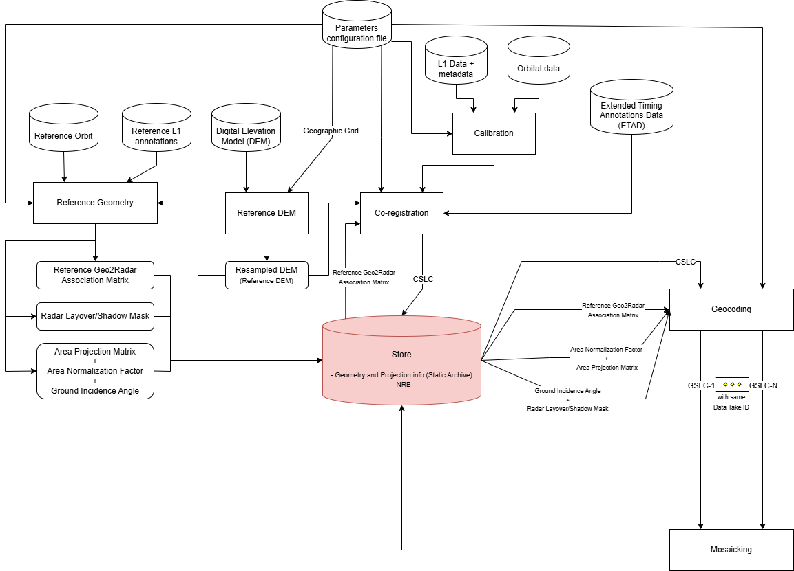

.. Copyright 2023 European Union

   Licensed under the Apache License, Version 2.0 (the "License");
   you may not use this file except in compliance with the License.
   You may obtain a copy of the License at

     http://www.apache.org/licenses/LICENSE-2.0

   Unless required by applicable law or agreed to in writing, software
   distributed under the License is distributed on an "AS IS" BASIS,
   WITHOUT WARRANTIES OR CONDITIONS OF ANY KIND, either express or implied.
   See the License for the specific language governing permissions and
   limitations under the License.

.. _nrb_label:

========================================================
Algorithm Theoretical Basis Document (ATBD) 
========================================================

The generation of NRB products involves several complex processing units and an overview of the processing workflow is reported in :numref:`NRB_diagram`.

.. _NRB_diagram_figure:

   *NRB* generation flow diagram.

The processing units involved are:

- :ref:`Ingestion <ingestion>`: The *Ingestion Unit* includes the steps for importing input SLC data, applying noise removal, amplitude calibration, and phase deramping.
- :ref:`Reference DEM <reference_DEM>`: The *Reference DEM Unit* includes the step for generating a DEM interpolated onto the output geographic grid of the geocoded ARD products.
- :ref:`Reference Geometry <reference_geometry>`: The *Reference Geometry Unit* includes all steps required to generate geometric information, stored in intermediate products, and needed by some *Co-registration* and *Geocoding* steps. The outputs of the *Reference Geometry Unit* can be stored in a static archive and reused by other processing units as needed.
- :ref:`Co-registration <coregistration>`: The *Co-registration Unit* produces CSLC products with respect to a reference radar grid ("real" or "virtual"). It is possible to apply models (e.g. ETAD corrections), or compute the corrections to the model based coregistration, through data-driven co-registration. In particular, the following techniques can be exploited: image cross-correlation (ICC), Enhanced spectral diversity (ESD) and split-specturm with respect to a real reference image.
- :ref:`Geocoding <geocoding>`: The *Geocoding Unit* uses CSLC and geometric information to extract GSLC/NRB products per burst or per swath (in the case of SM products). 
- :ref:`Mosaic <mosaicking>`: The *Mosaic Unit* merge NRB products tiled per burst or per swath obtained from the Geocoding step, and cut the obtained merged products according to the Sentinel-2 modified MGRS tiles.

.. note::

   The NRB product can be generated for each individual SLC image independently, thereby avoiding part of the co-registration step. 

   Alternatively, it can be generated for a stack of SLC images by aligning all images with respect to a reference image (real or virtual) in radar geometry.

   In either case, the *Co-registration Unit* is involved if timing correction is required, in order to resample the image in correspondence of the correct grid. In this way there is no asymmetry between the reference and theb secondary images. All the images are aligned in radar geometry compensating for timing errors, allowing the generation of all other products (e.g. GSLC, NRB, POL, CMLP, ...) in a consistent way.

   All the images before applying the data-driven co-registration, including the "real" reference image, are resampled in the reference radar grid.
   
   The output of the *Reference Geometry Unit* is used by the *Coregistration Unit* to align all the images, including the "real" reference image, to output reference grid (eventually "virtual").

   The *Geocoding Unit* internally performs the :ref:`noise-removal <noise_removal>` and :ref:`gamma-flattening <gamma_flattening>` steps before projecting the data. These operations are perfomrmed in radar geometry on the CSLC product.