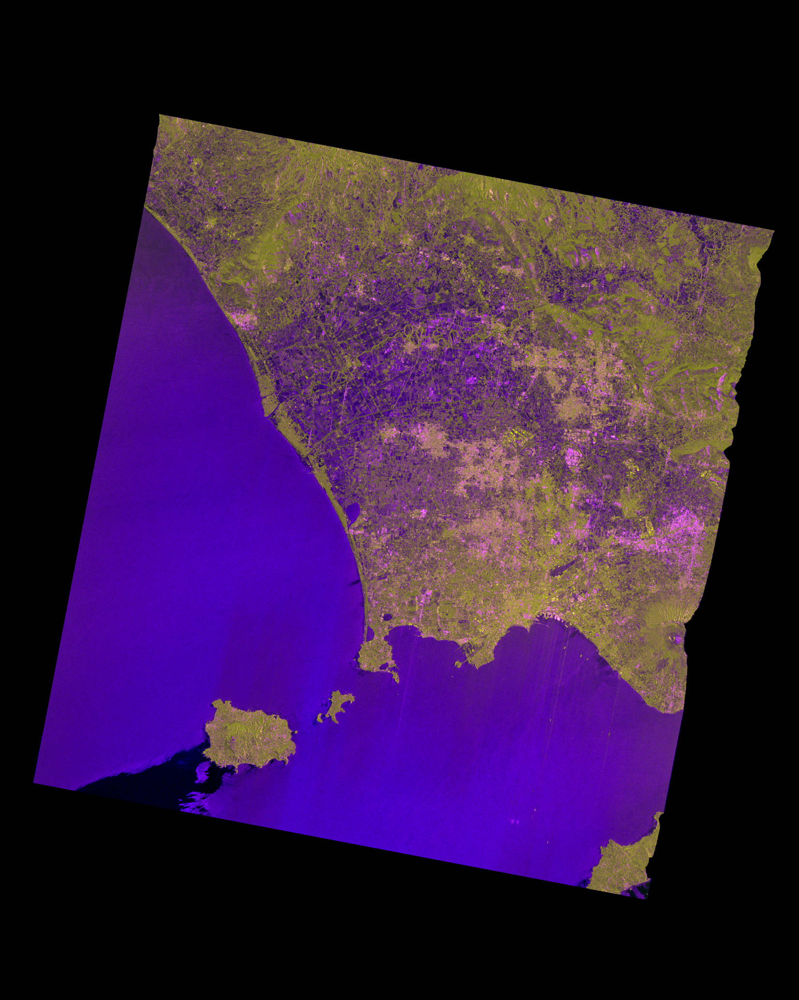

.. _nrb_data_vis:

==================
Data visualization
==================

POL products are currently stored in Zarr as folders (named COV or GCOV) with a number of subfolders (data layers) that depends on the number of polarimetric channels.

For instance, dual-pol data from SAOCOM comprise 3 layers which correspond to the C11, C12 and C22 entres of the dual-pol covariance matrix.

The values of each layer can be imported into python using the rosel.io.read function. 

Overview
--------

This script creates a false-colour RGB representation of a POL ARD product previously saved as COV or GCOV. The figure is saved as a PNG file.
    
Dependencies:
-------------
    - os
    - pathlib
    - numpy
    - rosel
    - PIL
    
Usage:
------

To use this script, define the following parameters:

- ``input_folder`` Path to the folder with preprocessed POL data
- ``product`` 'COV' or 'GCOV'
    
A file called 'COV_LinearRGB.png' or 'GCOV_LinearRGB.png' is saved in a
subfolder called 'figures' of the input folder.
    
Load packages and define auxiliary functions for the visualization
------------------------------------------------------------------

.. code-block:: python

    import numpy as np
    import os
    import pathlib
    
    import rosel.io
    import rosel.computation
    import rosel.shiroma
    
    from PIL import Image
    
    # Auxiliary functions
    
    def bytescl( data, lim, mask = None ):
        
        data_val = np.clip( (data - lim[0]) / (lim[1] - lim[0]), 0, 1)
                    
        data_byte = np.zeros_like( data_val, dtype=np.uint8)
        
        if mask is None:
               data_byte[:] = 255 * data_val[:]
        else:
               data_byte[mask] = 255 * data_val[mask]
        
        return data_byte
    
    def create_rgb_C2( C11, C22, C12, file_out ):
        
        # Save an RGB image from C11 and C22.
        # C12 is not used.
        
        Nrows, Ncols = C11.shape
        
        # dB scale
        
        C11_dB = 10*np.log10( C11 + 1e-12)
        C22_dB = 10*np.log10( 2*C22 + 1e-12)
        CH_dB =  10*np.log10( C11 / (C22 + 1e-12) + 1e-12)
        
        # Dynamic range
        
        mindB = -25
        maxdB = 5
        mindif = 0
        maxdif = 20
        
        # Create the RGB image
        
        RGB_image = np.zeros([Nrows, Ncols, 3], dtype=np.uint8)
        
        RGB_image[:,:,0] = bytescl( C11_dB, [mindB, maxdB]) # R
        RGB_image[:,:,1] = bytescl( C22_dB, [mindB, maxdB])  # G
        RGB_image[:,:,2] = bytescl( CH_dB, [mindif, maxdif]) # B
        
        Image.fromarray( RGB_image ).save( file_out )  
    
        im = Image.open( file_out )
        im.show()

Definition of parameters and output folder
------------------------------------------

.. code-block:: python

    # Input folder with pre-processsed images in CSLC format
    
    input_folder = '/home/juanma/MyStore/Users/Juanma/Processed_Data/SAOCOM/ARD/POL/Test/Naples/DSC/S4/POL/MULTI-LOOK/9x5/2021-02-28'
    
    # Product to be visualized: GCOV or COV
    
    product = 'GCOV' # 'COV' or 'GCOV'
    
    # Output folder for the figure
    
    output_folder = os.path.join( input_folder, 'figures')
    pathlib.Path(output_folder).mkdir(parents=True, exist_ok=True)

Reading of the POL product
--------------------------

.. code-block:: python

    # Read the 3 layers of a POL product
    
    C11 = rosel.io.read( os.path.join( input_folder, product, 'C11') ).v
    C22 = rosel.io.read( os.path.join( input_folder, product, 'C22') ).v
    C12 = rosel.io.read( os.path.join( input_folder, product, 'C12') ).v

RGB representation and file save
--------------------------------
.. code-block:: python

    # RGB representation (using only the intensities of the VV and VH channels)
    
    file_png = os.path.join( output_folder, product + '_' + 'LinearRGB.png')
    
    create_rgb_C2( C11, C22, C12, file_png )

 .. _POL_saocom_naples_dsc_s4:

   False colour RGB composite obtained from SAOCOM data over Naples (IT) acquired in descending geometry with beam S4.

